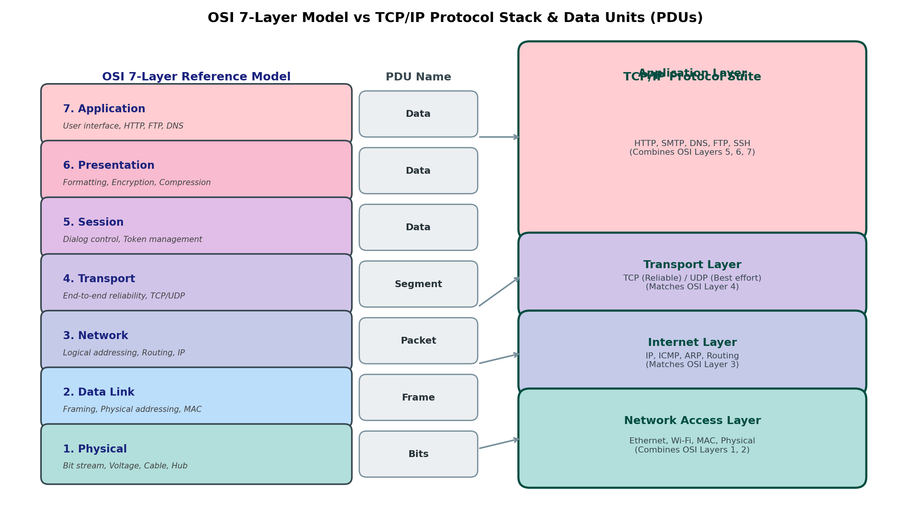
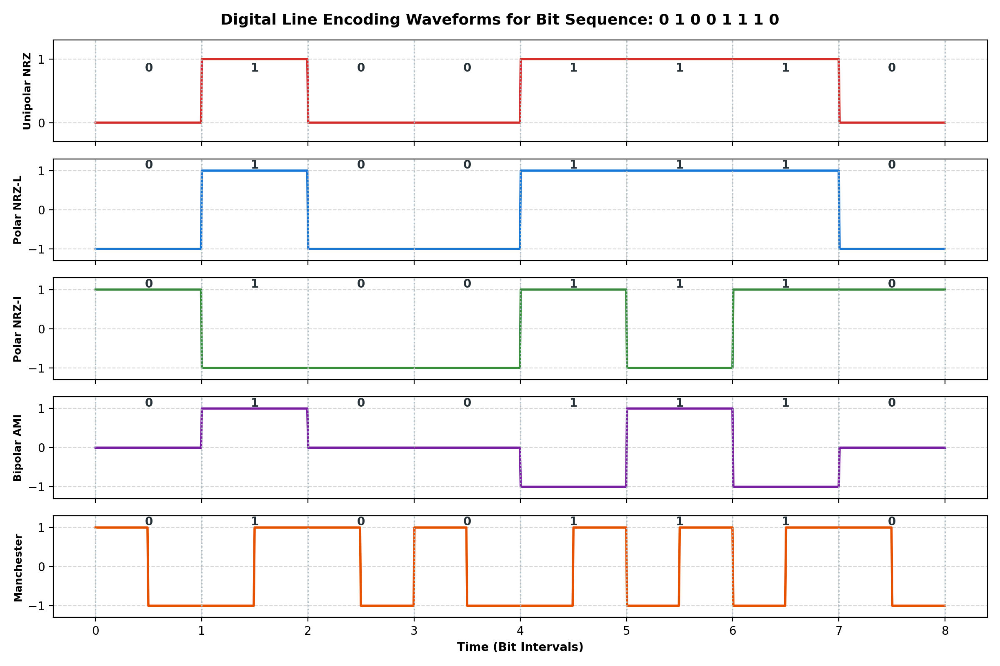
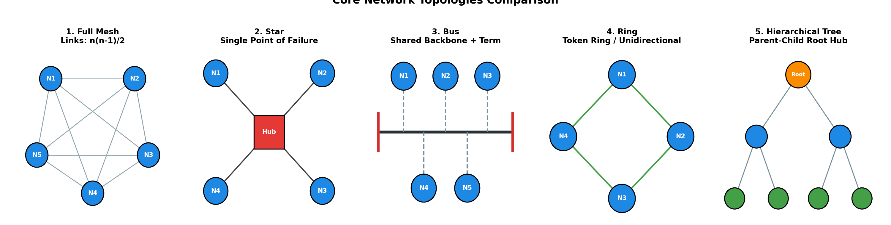
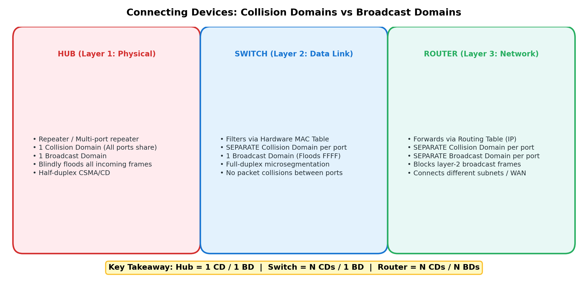
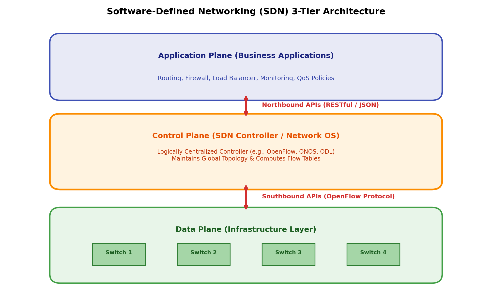

# CN Unit I: Networking Fundamentals & Physical Layer — Visual Diagrams & Drawing Guide

**Course Code**: CS3213 | **Subject**: Computer Networks  
**Generated Images**: High-resolution standalone PNG files located in `AI GENERATED/CN/Diagrams/`.  
Use this guide to review visual concepts and practice drawing diagrams by hand in your 2-hour exam.

---

## Diagram 1: OSI 7-Layer Model vs TCP/IP Protocol Stack & PDUs

**File**: `CN_Unit1_Diagram1_OSI_vs_TCPIP.png`



### Exam ASCII Redraw Format:
```text
OSI 7-Layer Model               PDU Name               TCP/IP Suite
+----------------------+      +----------+        +----------------------+
| 7. Application       | ---> |   Data   | -----> |                      |
| 6. Presentation      | ---> |   Data   | -----> |  Application Layer   |
| 5. Session           | ---> |   Data   | -----> | (HTTP, DNS, SSH, FTP)|
+----------------------+      +----------+        +----------------------+
| 4. Transport         | ---> | Segment  | -----> | Transport (TCP / UDP)|
+----------------------+      +----------+        +----------------------+
| 3. Network           | ---> |  Packet  | -----> | Internet Layer (IP)  |
+----------------------+      +----------+        +----------------------+
| 2. Data Link         | ---> |  Frame   | -----> | Network Access Layer |
| 1. Physical          | ---> |   Bits   | -----> | (Ethernet, Wi-Fi)    |
+----------------------+      +----------+        +----------------------+
```
**Exam Memory Tip**:
- Mnemonic for OSI Layers (Bottom to Top): **P**lease **D**o **N**ot **T**hrow **S**ausage **P**izza **A**way (Physical, Data Link, Network, Transport, Session, Presentation, Application).
- Mnemonic for PDUs: **B**its, **F**rames, **P**ackets, **S**egments, **D**ata (Bottom to Top: **B**ig **F**oot **P**acks **S**ome **D**ata).

---

## Diagram 2: Digital Line Encoding Waveforms (0 1 0 0 1 1 1 0)

**File**: `CN_Unit1_Diagram2_LineEncodingWaveforms.png`



### Exam ASCII Redraw Format:
```text
Bit Stream:       0       1       0       0       1       1       1       0
Interval:       [ 1 ]   [ 2 ]   [ 3 ]   [ 4 ]   [ 5 ]   [ 6 ]   [ 7 ]   [ 8 ]

1. Unipolar NRZ:
   +V |          +-------+               +---------------+-------+
    0 |  +-------+       +-------+-------+                       +-------+

2. Polar NRZ-L (0 = -V, 1 = +V):
   +V |          +-------+               +---------------+-------+
   -V |  +-------+       +-------+-------+                       +-------+

3. Polar NRZ-I (Invert on 1):
   +V |          +-------+-------+-------+       +---------------+-------+
   -V |  +-------+                       +-------+

4. Bipolar AMI (0 = 0V, 1 alternates +V and -V):
   +V |          +-------+                       +---------------+
    0 |  +-------+       +-------+-------+       +               +-------+
   -V |                                  +-------+

5. Manchester (IEEE 802.3: 0 = High->Low, 1 = Low->High):
   +V |  +--+       +--+    +--+    +--+       +--+    +--+    +--+ +--+
   -V |     +--+ +--+  | +--+  | +--+  | +--+ +--+  | +--+  | +--+  |  +--+
        H -> L   L -> H  H -> L  H -> L  L -> H   L -> H  L -> H    H -> L
```

---

## Diagram 3: Network Topologies

**File**: `CN_Unit1_Diagram3_NetworkTopologies.png`



### Exam ASCII Redraw Format:
```text
1. Full Mesh (n=4):                 2. Star (n=4):
     [N1] --------- [N2]                  [N1]     [N2]
       |  \       /  |                      \       /
       |    \   /    |                       [Switch]
       |      X      |                      /       \
       |    /   \    |                    [N3]     [N4]
     [N3] --------- [N4]            Links = n = 4
     Links = n(n-1)/2 = 6

3. Bus:                             4. Ring:
   [Term]==================[Term]        [N1] -----> [N2]
       |     |     |     |                ^            |
     [N1]  [N2]  [N3]  [N4]               |            v
     Shared Backbone Cable               [N4] <----- [N3]
                                         Unidirectional Token Loop
```

---

## Diagram 4: Connecting Devices & Collision / Broadcast Domains

**File**: `CN_Unit1_Diagram4_ConnectingDevicesLayers.png`



### Exam ASCII Redraw Format:
```text
+-----------------------+   +-----------------------+   +-----------------------+
|          HUB          |   |        SWITCH         |   |        ROUTER         |
|  (Layer 1: Physical)  |   | (Layer 2: Data Link)  |   |  (Layer 3: Network)   |
|                       |   |                       |   |                       |
|  • 1 Collision Domain |   |  • N Collision Domains|   |  • N Collision Domains|
|  • 1 Broadcast Domain |   |  • 1 Broadcast Domain |   |  • N Broadcast Domains|
|                       |   |                       |   |                       |
|  Floods blindly to all|   |  Filters by MAC Table |   |  Routes by IP Table   |
|  ports (Half-Duplex)  |   |  (Full-Duplex Switched|   |  (Blocks L2 Broadcast)|
+-----------------------+   +-----------------------+   +-----------------------+
```

---

## Diagram 5: Software-Defined Networking (SDN) 3-Tier Architecture

**File**: `CN_Unit1_Diagram5_SDN_Architecture.png`



### Exam ASCII Redraw Format:
```text
+-------------------------------------------------------------+
|                     APPLICATION PLANE                       |
|   Routing, Firewall, Load Balancer, Monitoring, QoS Policy  |
+-------------------------------------------------------------+
                              ^
                              |  Northbound APIs (RESTful / JSON)
                              v
+-------------------------------------------------------------+
|               CONTROL PLANE (SDN CONTROLLER)                |
|      Logically Centralized Brain (OpenDaylight, ONOS)       |
|    Maintains Global Topology & Computes Flow Tables         |
+-------------------------------------------------------------+
                              ^
                              |  Southbound APIs (OpenFlow Protocol)
                              v
+-------------------------------------------------------------+
|                        DATA PLANE                           |
|            Infrastructure Forwarding Switches               |
|      [Switch 1]      [Switch 2]      [Switch 3]             |
+-------------------------------------------------------------+
```
