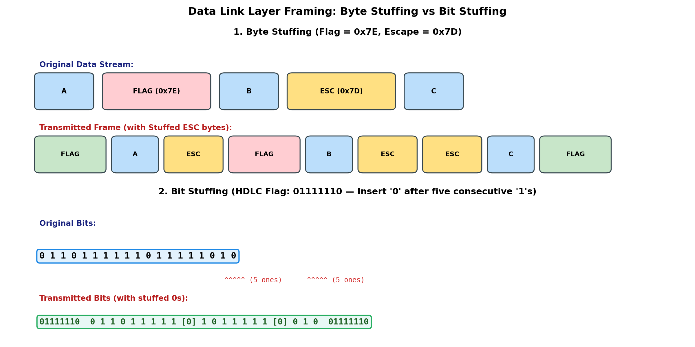
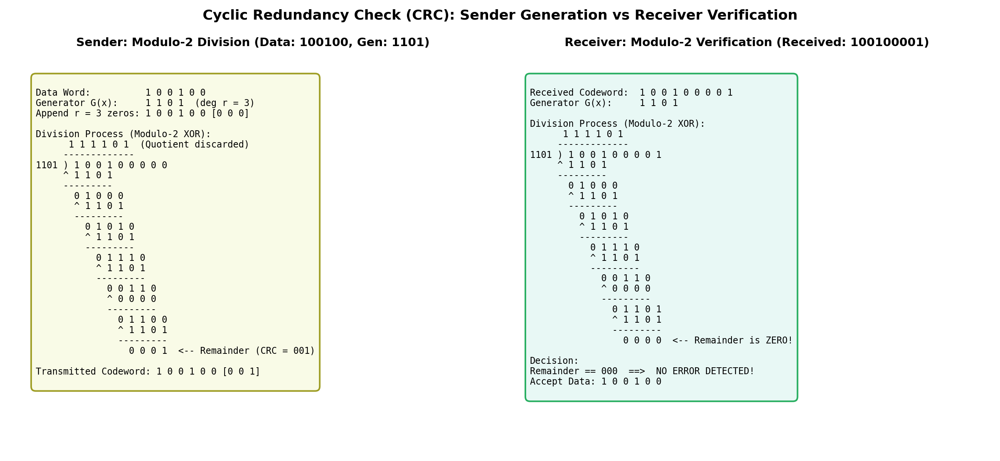
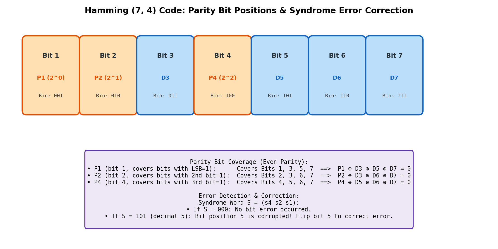
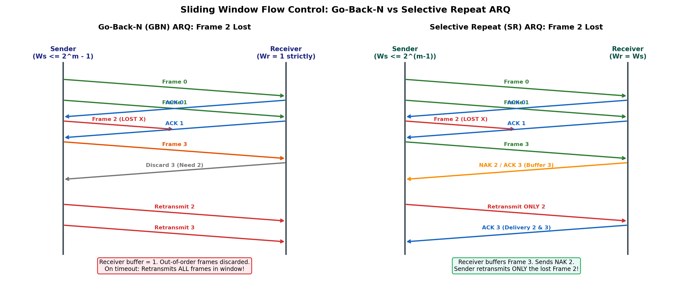
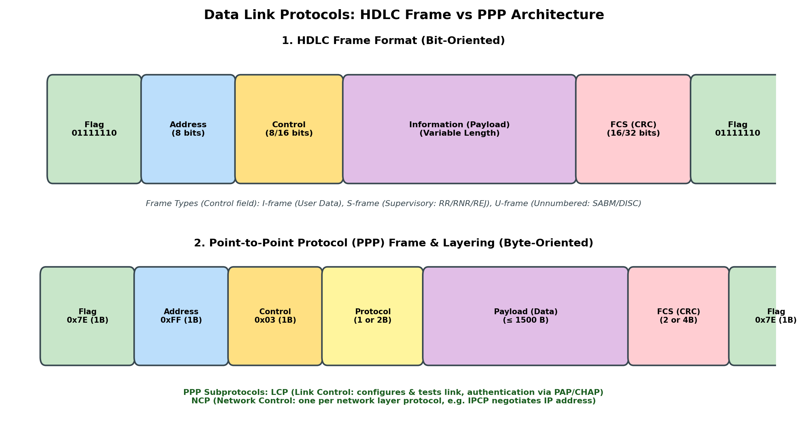

# CN Unit II: Logical Link Control (Data Link Layer) — Visual Diagrams & Drawing Guide

**Course Code**: CS3213 | **Subject**: Computer Networks  
**Generated Images**: High-resolution standalone PNG files located in `AI GENERATED/CN/Diagrams/`.  
Use this guide to review visual concepts and practice drawing diagrams by hand in your 2-hour exam.

---

## Diagram 1: Framing Techniques: Byte Stuffing vs Bit Stuffing

**File**: `CN_Unit2_Diagram1_FramingTechniques.png`



### Exam ASCII Redraw Format:
```text
1. Byte Stuffing (PPP):
Original Data:       [ A ]  [ FLAG ]  [ B ]  [ ESC ]  [ C ]
Transmitted Frame:   [FLAG] [ A ] [ESC] [FLAG] [ B ] [ESC] [ESC] [ C ] [FLAG]
Rule: Insert 'ESC' byte before any accidental FLAG or ESC in data.

2. Bit Stuffing (HDLC):
Original Data:       0 1 1 1 1 1 1 0 1 1 1 1 1 0 0
Stuffed Stream:      0 1 1 1 1 1 [0] 1 0 1 1 1 1 1 [0] 0 0
Rule: Insert a '0' bit after every five consecutive '1's.
```

---

## Diagram 2: Cyclic Redundancy Check (CRC) Generation & Verification

**File**: `CN_Unit2_Diagram2_CRC_Division.png`



### Exam ASCII Redraw Format:
```text
Data: 100100   Generator G(x): 1101 (deg r = 3)   Append 3 zeros: 100100000

Sender Division (Modulo-2 XOR):
1101 ) 1 0 0 1 0 0 0 0 0
     ^ 1 1 0 1
     ---------
       0 1 0 0 0
       ^ 1 1 0 1
       ---------
         0 1 0 1 0
         ^ 1 1 0 1
         ---------
           0 1 1 1 0
           ^ 1 1 0 1
           ---------
             0 0 1 1 0
             ^ 0 0 0 0
             ---------
               0 1 1 0 0
               ^ 1 1 0 1
               ---------
                 0 0 0 1   <-- Remainder R = 001

Transmitted Codeword: 1 0 0 1 0 0 [ 0 0 1 ]
Receiver Division: Divide 100100001 by 1101 ==> Remainder == 000 (No Error!)
```

---

## Diagram 3: Hamming Code Bit Structure & Error Syndrome

**File**: `CN_Unit2_Diagram3_HammingCode.png`



### Exam ASCII Redraw Format:
```text
Bit Position:    1     2     3     4     5     6     7
Bit Role:       P1    P2    D3    P4    D5    D6    D7
Binary Pos:    001   010   011   100   101   110   111

Parity Coverage (Even Parity):
P1 (bit 1, LSB = 1):     Checks 1, 3, 5, 7  ==>  P1 ⊕ D3 ⊕ D5 ⊕ D7 = 0
P2 (bit 2, 2nd bit = 1): Checks 2, 3, 6, 7  ==>  P2 ⊕ D3 ⊕ D6 ⊕ D7 = 0
P4 (bit 4, 3rd bit = 1): Checks 4, 5, 6, 7  ==>  P4 ⊕ D5 ⊕ D6 ⊕ D7 = 0

Syndrome S = (s4 s2 s1): Decimal value indicates exact corrupted bit position!
```

---

## Diagram 4: Sliding Window Protocols: Go-Back-N vs Selective Repeat

**File**: `CN_Unit2_Diagram4_SlidingWindowARQ.png`



### Exam ASCII Redraw Format:
```text
Go-Back-N (Frame 2 Lost):                 Selective Repeat (Frame 2 Lost):
Sender (Ws=4)          Receiver (Wr=1)    Sender (Ws=4)          Receiver (Wr=4)
  | --- Frame 0 ------> | (Accept 0)        | --- Frame 0 ------> | (Accept 0)
  | --- Frame 1 ------> | (Accept 1)        | --- Frame 1 ------> | (Accept 1)
  | --- Frame 2 (LOST)  |                   | --- Frame 2 (LOST)  |
  | --- Frame 3 ------> | (DISCARD 3!)      | --- Frame 3 ------> | (BUFFER 3!)
  |                     |                   |                     |
  | <== TIMEOUT FOR 2   |                   | <== NAK 2 ========= |
  | --- Retransmit 2 -> | (Accept 2)        | --- Retransmit 2 -> | (Accept 2 & Deliver 3)
  | --- Retransmit 3 -> | (Accept 3)        |                     |
  (Retransmits ALL frames in window!)       (Retransmits ONLY the lost frame!)
```

---

## Diagram 5: HDLC vs PPP Frame Formats

**File**: `CN_Unit2_Diagram5_HDLC_PPP_Frames.png`



### Exam ASCII Redraw Format:
```text
1. HDLC Frame (Bit-Oriented):
+----------+----------+----------+-----------------------+----------+----------+
|   FLAG   | ADDRESS  | CONTROL  |  INFORMATION (DATA)   |   FCS    |   FLAG   |
| 01111110 | (8 bits) | (8 bits) |   (Variable Length)   | (16 bits)| 01111110 |
+----------+----------+----------+-----------------------+----------+----------+
Types: I-frame (User Data), S-frame (RR, RNR, REJ), U-frame (SABM, DISC)

2. PPP Frame (Byte-Oriented):
+----------+----------+----------+----------+-----------------------+----------+----------+
|   FLAG   | ADDRESS  | CONTROL  | PROTOCOL |    PAYLOAD (DATA)     |   FCS    |   FLAG   |
|   0x7E   |   0xFF   |   0x03   | (1 or 2B)|    (≤ 1500 Bytes)     | (2 or 4B)|   0x7E   |
+----------+----------+----------+----------+-----------------------+----------+----------+
Subprotocols: LCP (Link setup, PAP/CHAP auth), NCP (IPCP negotiates IP)
```
