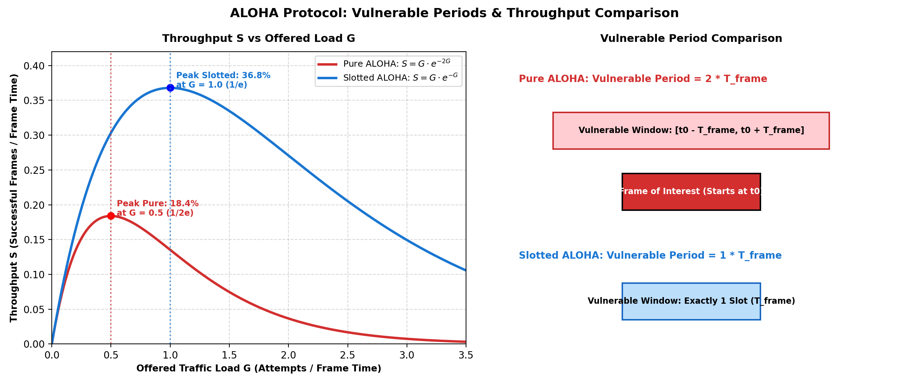
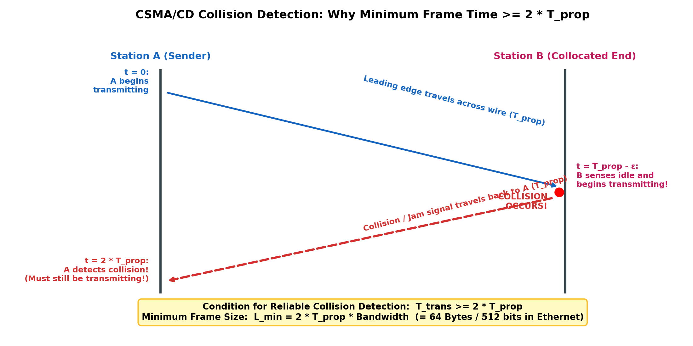
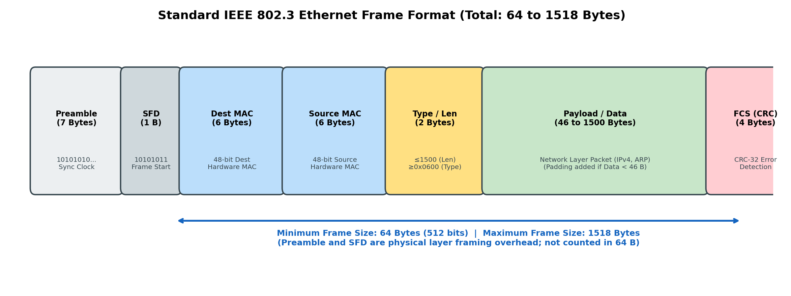
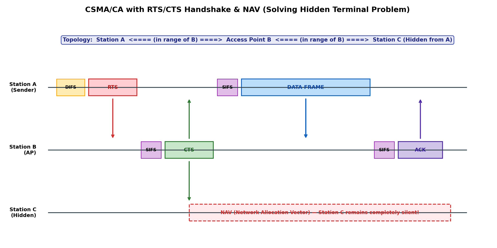
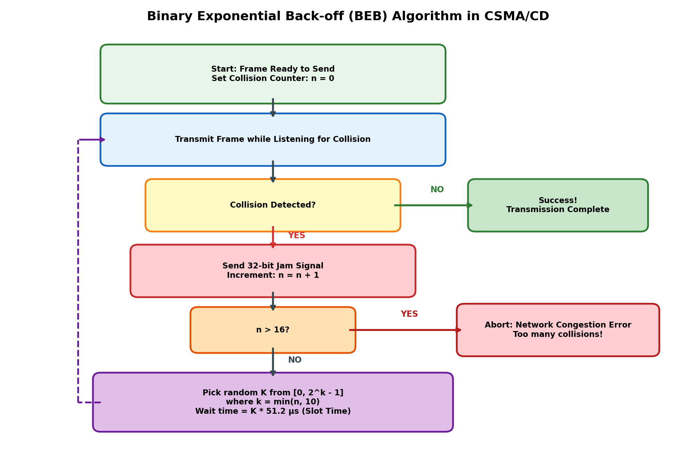

# CN Unit III: Medium Access Control (MAC Sublayer) — Visual Diagrams & Drawing Guide

**Course Code**: CS3213 | **Subject**: Computer Networks  
**Generated Images**: High-resolution standalone PNG files located in `AI GENERATED/CN/Diagrams/`.  
Use this guide to review visual concepts and practice drawing diagrams by hand in your 2-hour exam.

---

## Diagram 1: ALOHA Vulnerable Periods & Throughput Curves

**File**: `CN_Unit3_Diagram1_ALOHA_Comparison.png`



### Exam ASCII Redraw Format:
```text
1. Pure ALOHA Vulnerable Period (2 * T):
   Frame of interest starts at t0:   [   Frame   ]
   Vulnerable Interval:       [------- 2 * T -------]
                              (t0 - T)   t0   (t0 + T)
   Throughput S = G * e^(-2G)  ==> Max = 1/(2e) ≈ 18.4% at G = 0.5

2. Slotted ALOHA Vulnerable Period (1 * T):
   Slots:            |   Slot k   |  Slot k+1  |
   Frame Transmits:  | [  Frame ] |            |
   Vulnerable Window:| <-- 1*T -> |
   Throughput S = G * e^(-G)   ==> Max = 1/e ≈ 36.8% at G = 1.0 (Doubled!)
```

---

## Diagram 2: CSMA/CD Minimum Frame Length Collision Window (2 * T_prop)

**File**: `CN_Unit3_Diagram2_CSMA_CD_MinFrame.png`



### Exam ASCII Redraw Format:
```text
Station A (Sender)                                  Station B (Receiver)
   |                                                   |
t=0| --- A begins transmitting ---------------------> |
   |                                                   | t = T_prop - ε: B senses idle
   |                                                   | and begins transmitting!
   |                                                   X COLLISION at t = T_prop!
   |                                                  /
   | <--- Collision/Jam signal propagates back ------+
   |                                                   |
t = 2*T_prop: A detects collision!                     |
(A must STILL be transmitting to recognize collision!)

Condition:  T_trans >= 2 * T_prop  ==>  L_min >= 2 * T_prop * Bandwidth
Standard Ethernet: L_min = 64 Bytes (512 bits)  |  Slot Time = 51.2 μs
```

---

## Diagram 3: IEEE 802.3 Ethernet Frame Format

**File**: `CN_Unit3_Diagram3_EthernetFrameFormat.png`



### Exam ASCII Redraw Format:
```text
+----------+------+----------+----------+----------+-----------------------+----------+
| PREAMBLE | SFD  | DEST MAC | SRC MAC  | TYPE/LEN |     PAYLOAD (DATA)    |   FCS    |
| (7 Bytes)| (1B) | (6 Bytes)| (6 Bytes)| (2 Bytes)|   (46 to 1500 Bytes)  | (4 Bytes)|
| 10101010 |101010| 48-bit   | 48-bit   | <=1500: L| (Pad if Data < 46 B)  |  CRC-32  |
|   ...    |  11  | Hardware | Hardware | >=0x600:T|                       |          |
+----------+------+----------+----------+----------+-----------------------+----------+
|<-- Physical Overhead -->|<---------------- 64 to 1518 Bytes ------------------------->|
```

---

## Diagram 4: CSMA/CA Virtual Carrier Sensing with RTS/CTS & NAV

**File**: `CN_Unit3_Diagram4_CSMA_CA_RTS_CTS.png`



### Exam ASCII Redraw Format:
```text
Station A:    [DIFS] [ RTS ]             [SIFS] [   DATA FRAME   ]
                |      |                   |          |
                v      |                   v          |
AP B:                  |   [SIFS] [ CTS ]             |   [SIFS] [ ACK ]
                       |     |      |                 |     |      |
                       +-----+      +-----------------+     +------+
                                    |
Hidden C:                           | <======== NAV (Timer) =======> |
                                      (C hears CTS, sets NAV, stays silent!)
```

---

## Diagram 5: Binary Exponential Back-off Flowchart

**File**: `CN_Unit3_Diagram5_BEB_Flowchart.png`



### Exam ASCII Redraw Format:
```text
           [ Start: Frame Ready, Collision Counter n = 0 ]
                                 |
                                 v
          +------------> [ Transmit while Listening ]
          |                      |
          |               Collision Detected?
          |             /                     \
          |        (No)                         (Yes)
          |          |                            |
          |   [ Success! Done ]         [ Send 32-bit Jam Signal ]
          |                             [      n = n + 1         ]
          |                                       |
          |                                    n > 16?
          |                                  /         \
          |                            (Yes)             (No)
          |                              |                 |
          |                    [ Abort: Congestion ]   Set k = min(n, 10)
          |                                            Pick K in [0, 2^k - 1]
          |                                            Wait K * 51.2 μs
          +----------------------------------------------------+
```
