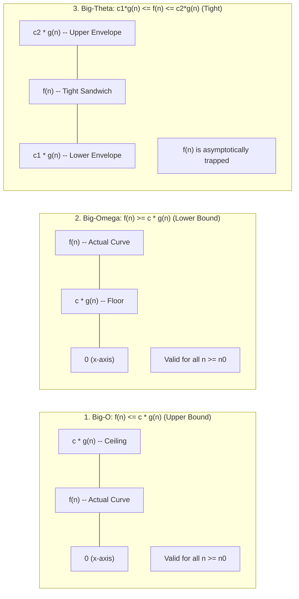
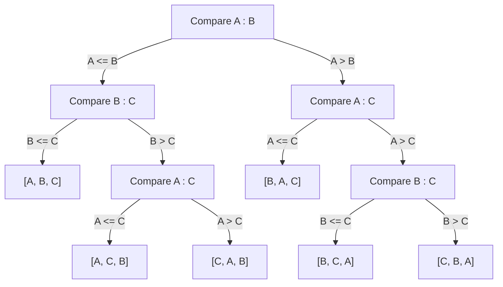
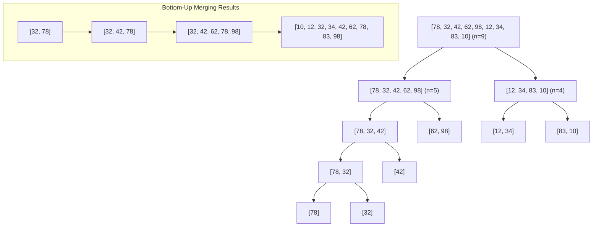
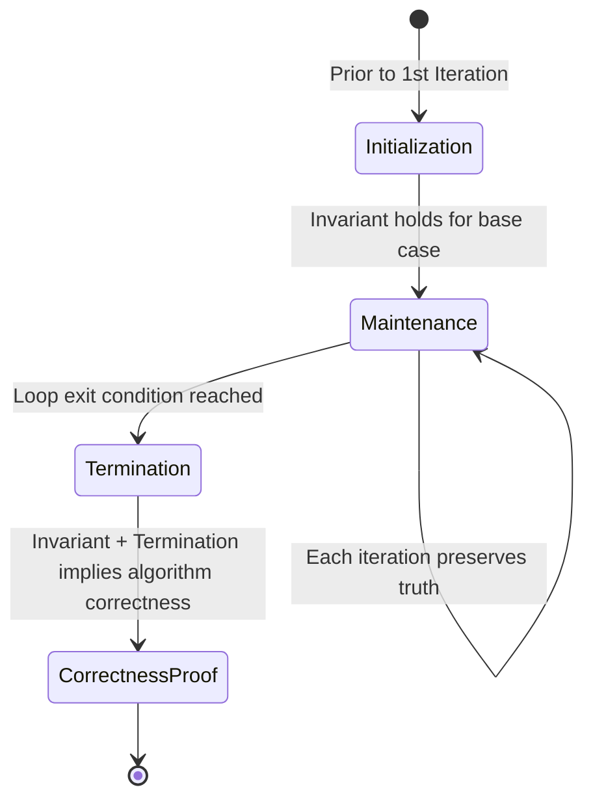

# DAA Unit I: Visual Exam Diagrams

> **Course:** CS3212 — Design and Analysis of Algorithms  
> **Topic:** Unit I (Complexity Analysis, Bounds, Sorting Trees, Graph Traversals)  
> **Note:** Every diagram below includes both a **Direct Visual ASCII Sketch** (for immediate viewing and quick redrawing on exam paper) and a **Mermaid Code Block**.

---

## Diagram 1: Asymptotic Bounding Curves (Big-O, Big-Omega, Big-Theta)

### How to Draw in Exam (30 Seconds):
Draw an x-axis (labeled $n$) and a y-axis (labeled $T(n)$). Draw a dashed vertical line at $n_0$ to show where the inequality starts holding.

### Visual ASCII Sketch:

```text
1. Big-O: f(n) ≤ c · g(n)          2. Big-Ω: f(n) ≥ c · g(n)          3. Big-Θ: c1·g(n) ≤ f(n) ≤ c2·g(n)
   (Asymptotic Upper Bound)           (Asymptotic Lower Bound)           (Asymptotic Tight Bound)

   Time                               Time                               Time
    ^                                  ^                                  ^
    |          / c · g(n) [Ceiling]    |            / f(n) [Actual]       |          / c2 · g(n) [Upper]
    |         /                        |           /                      |         /   / f(n) [Sandwiched]
    |        /    / f(n) [Actual]      |          /    / c · g(n) [Floor] |        /   /   / c1 · g(n) [Lower]
    |       /    /                     |         /    /                   |       /   /   /
    |      /    /                      |        /    /                    |      /   /   /
    |     /    /                       |       /    /                     |     /   /   /
    |----+----+--------> n             |----+----+--------> n             |----+---+---+--------> n
    0    |    n0                       0    |    n0                       0    |   n0
         |<-- Valid region -->              |<-- Valid region -->              |<-- Valid region -->
```

### Mermaid Code:


---

## Diagram 2: Decision Tree for Sorting Lower Bound (Ω(n log n))

### How to Draw in Exam:
Draw a binary tree for $n=3$ elements ($A, B, C$). Show comparisons at circles/boxes and the resulting permutations at the leaves.

### Visual ASCII Sketch:

```text
                         [ Compare A : B ]
                           /           \
                     (A ≤ B)           (A > B)
                     /                       \
           [ Compare B : C ]             [ Compare A : C ]
              /         \                   /         \
         (B ≤ C)       (B > C)         (A ≤ C)       (A > C)
          /                 \           /                 \
     [A, B, C]     [ Compare A : C ] [B, A, C]     [ Compare B : C ]
       Leaf 1         /         \      Leaf 4         /         \
                 (A ≤ C)       (A > C)           (B ≤ C)       (B > C)
                  /                 \             /                 \
             [A, C, B]           [C, A, B]   [B, C, A]           [C, B, A]
               Leaf 2              Leaf 3      Leaf 5              Leaf 6

========================================================================
EXAM MARKING FORMULA TO WRITE BESIDE THIS TREE:
  • Number of distinct permutations = n!
  • Therefore, Number of Leaves L ≥ n!
  • A binary tree of height h has at most 2ʰ leaves:  2ʰ ≥ L ≥ n!
  • Taking log₂ on both sides:  h ≥ log₂(n!) = Ω(n log n)
  • Height h = worst-case comparisons  ==>  Lower Bound is Ω(n log n)
========================================================================
```

### Mermaid Code:


---

## Diagram 3: Merge Sort Divide-and-Conquer Recursion Tree

### Problem Traced:
`[78, 32, 42, 62, 98, 12, 34, 83, 10]` (Length $n = 9$)

### Visual ASCII Sketch:

```text
DIVIDE PHASE (Top-Down Splitting):
                         [ 78, 32, 42, 62, 98, 12, 34, 83, 10 ]
                                   /                 \
                 [ 78, 32, 42, 62, 98 ]           [ 12, 34, 83, 10 ]
                    /             \                   /           \
             [ 78, 32, 42 ]     [ 62, 98 ]       [ 12, 34 ]     [ 83, 10 ]
               /        \         /    \           /    \         /    \
           [ 78, 32 ]   [ 42 ]  [ 62 ] [ 98 ]   [ 12 ] [ 34 ]   [ 83 ] [ 10 ]
            /     \
         [ 78 ]  [ 32 ]

CONQUER & MERGE PHASE (Bottom-Up Merging):
         [ 78 ]  [ 32 ]
            \     /
           [ 32, 78 ]   [ 42 ]
               \        /
             [ 32, 42, 78 ]     [ 62, 98 ]       [ 12, 34 ]     [ 10, 83 ]
                    \             /                   \           /
                 [ 32, 42, 62, 78, 98 ]           [ 10, 12, 34, 83 ]
                                   \                 /
                         [ 10, 12, 32, 34, 42, 62, 78, 83, 98 ]  <-- Final Sorted Array!
```

### Mermaid Code:


---

## Diagram 4: Kahn's Algorithm for Topological Sorting (In-Degree Queue Flow)

### Visual ASCII Sketch:

```text
       +-------------------------------------------------------+
       |   Compute in-degree for every vertex in graph G       |
       +-------------------------------------------------------+
                                   |
                                   v
       +-------------------------------------------------------+
       |   Enqueue all vertices having in-degree = 0           |
       +-------------------------------------------------------+
                                   |
                                   v
       +-----------------------> [ Is Queue Empty? ] <----------+
       |                                   |                    |
       |                             (No)  |  (Yes)             |
       |                                   |                    |
       |                                   v                    v
       |                    +------------------------+   [ Check Count ]
       |                    | Dequeue vertex u       |          |
       |                    | Append u to output     |          +---> Count == |V| ?
       |                    +------------------------+                  |
       |                                   |                            |--(Yes)--> [ Valid Topological Sort! ]
       |                                   v                            |
       |                    +------------------------+                  +--(No)---> [ Cycle Detected! DAG Failed ]
       |                    | For each edge (u, v):  |
       |                    |   in-degree[v] -= 1    |
       |                    +------------------------+
       |                                   |
       |                                   v
       |                    [ Did in-degree[v] reach 0? ]
       |                                   |
       |                             (Yes) |  (No)
       |                                   |   |
       |                                   v   |
       |                    +------------------+
       +--------------------| Enqueue v        |
                            +------------------+
```

### Mermaid Code:
```mermaid
flowchart TD
    Start([Calculate In-Degree for all V]) --> EnqueueZero[Enqueue all Vertices with in-degree = 0]
    EnqueueZero --> CheckQ{Is Queue Empty?}
    
    CheckQ -- No --> Dequeue[Dequeue Vertex u]
    Dequeue --> AddOutput[Append u to Output List]
    AddOutput --> DecNeighbors["For each edge (u, v): in-degree[v] = in-degree[v] - 1"]
    
    DecNeighbors --> CheckNeighbor{Did in-degree[v] reach 0?}
    CheckNeighbor -- Yes --> EnqueueV[Enqueue vertex v]
    CheckNeighbor -- No --> CheckQ
    EnqueueV --> CheckQ

    CheckQ -- Yes --> CheckCount{Processed Count == |V|?}
    CheckCount -- Yes --> ValidDAG([Valid Topological Ordering Found - O(V+E)])
    CheckCount -- No --> CycleFound([Cycle Detected! Not a DAG])
```

---

## Diagram 5: Loop Invariant Proof Cycle

### Visual ASCII Sketch:

```text
    +-----------------------------------------------------------------+
    | 1. INITIALIZATION (Base Case)                                   |
    |    Prove the invariant condition is TRUE before loop begins.    |
    +-----------------------------------------------------------------+
                                    |
                                    v
    +-----------------------------------------------------------------+
    | 2. MAINTENANCE (Inductive Step)                                 |
    |    Show that if invariant is TRUE before iteration k,           |
    |    it remains TRUE immediately before iteration k + 1.          |
    +-----------------------------------------------------------------+
                                    |
                                    v
    +-----------------------------------------------------------------+
    | 3. TERMINATION (Correctness Guarantee)                          |
    |    Loop exits when condition fails. The invariant combined with |
    |    the exit condition proves the algorithm computed correctly.  |
    +-----------------------------------------------------------------+
```

### Mermaid Code:

