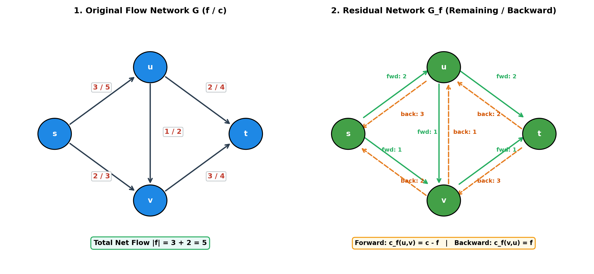
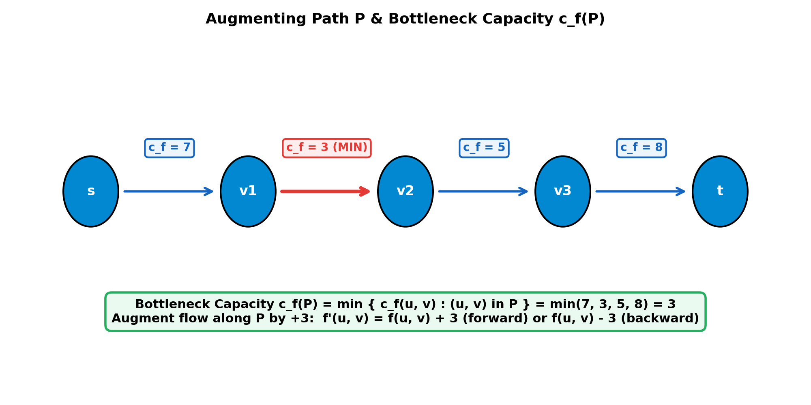
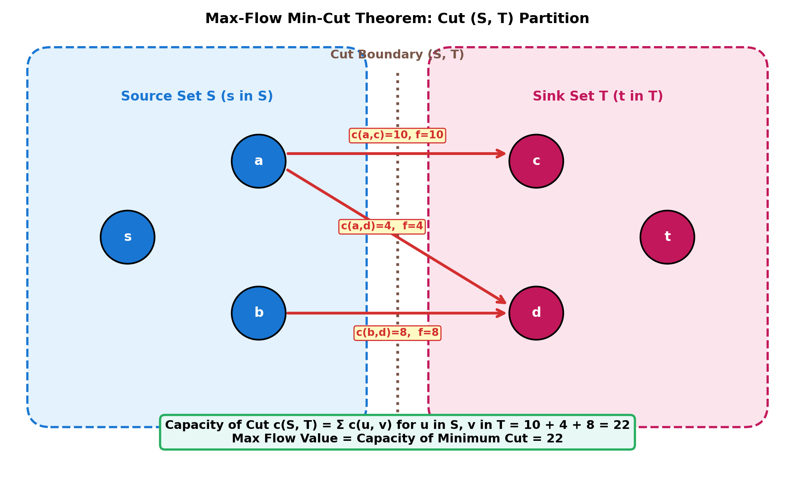
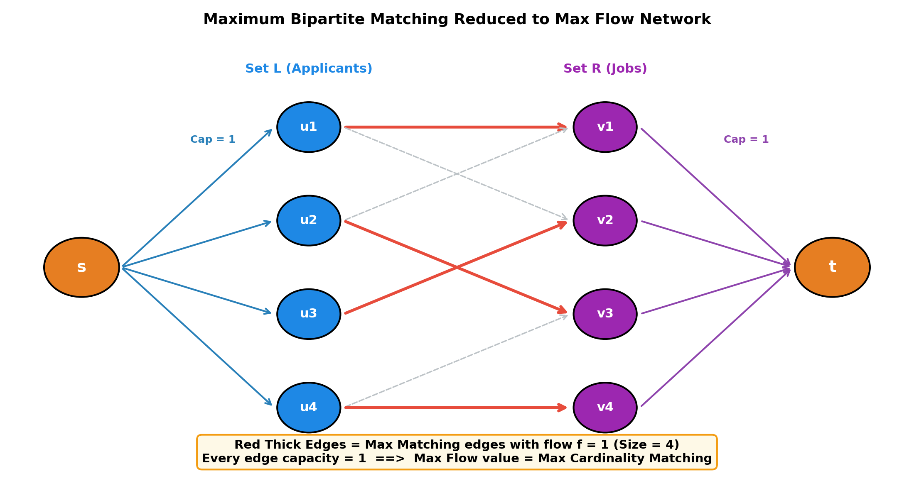
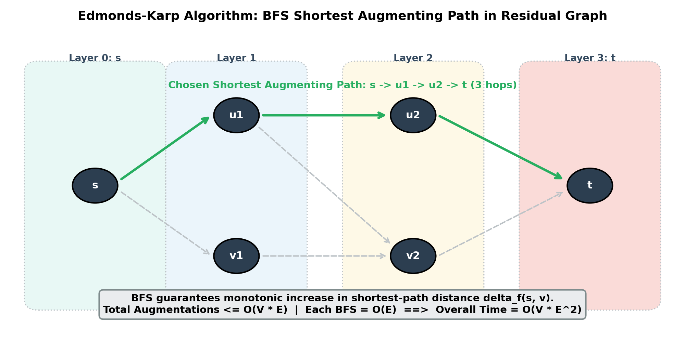

# DAA Unit V: Network Flows Optimization — Visual Diagrams & Drawing Guide

**Course Code**: CS3212 | **Subject**: Design and Analysis of Algorithms  
**Generated Images**: High-resolution standalone PNG files located in `AI GENERATED/DAA/Diagrams/`.  
Use this guide to review visual concepts and practice drawing diagrams by hand in your 2-hour exam.

---

## Diagram 1: Flow Network G vs Residual Network G_f

**File**: `DAA_Unit5_Diagram1_FlowNetworkResidual.png`



### Exam ASCII Redraw Format:
```text
Original Network G (flow / capacity):
            (3 / 5)
       [s] ----------> [u]
        |  \            |  \  (2 / 4)
        |   \ (1 / 2)   |   \
 (2 / 3)|    v          v    v
        |   [v]       [v]    [t]
        |  /            |    ^
        v v             v   / (3 / 4)
       [v] ------------> [t]

Residual Network G_f:
Forward edge c_f(u, v) = c - f   (remaining forward capacity)
Backward edge c_f(v, u) = f      (capacity to cancel/undo flow)

              [u]
          2 / ^ \ 2
           /  |  \
          / 3 |   \ 2
        s     v     t
          \ 2 |   / 3
           \  |  /
          1 \ v / 1
              [v]
```
**Key Rule to Draw**:
1. Label edges in original graph as `f(u, v) / c(u, v)`.
2. In residual network, if flow `f > 0`, draw a dotted/backward arrow with weight `f`. If `f < c`, draw a solid forward arrow with weight `c - f`.

---

## Diagram 2: Augmenting Path & Bottleneck Capacity

**File**: `DAA_Unit5_Diagram2_AugmentingPathUpdate.png`



### Exam ASCII Redraw Format:
```text
Residual Path P in G_f:

   [s] -----(7)-----> [v1] -----(3)-----> [v2] -----(5)-----> [v3] -----(8)-----> [t]
                                 ^
                                 |
                         BOTTLENECK EDGE!
                     c_f(P) = min(7, 3, 5, 8) = 3

Flow Update:
For each forward edge:  f(u, v) = f(u, v) + 3
For each backward edge: f(v, u) = f(v, u) - 3
New Net Flow:           |f'|    = |f| + 3
```

---

## Diagram 3: Max-Flow Min-Cut Theorem (Cut Partition)

**File**: `DAA_Unit5_Diagram3_MaxFlowMinCut.png`



### Exam ASCII Redraw Format:
```text
+-----------------------+   Cut Boundary   +-----------------------+
|   PARTITION S         |        :         |   PARTITION T         |
|   (Source side)       |        :         |   (Sink side)         |
|                       |        :         |                       |
|        [a] -------------------(10)------------> [c]              |
|       ^    \          |        :         |          \            |
|      /      \         |        :         |           \           |
|   [s]        \-----------------(4)------------> [d]    \---> [t]  |
|      \                |        :         |           /           |
|       v               |        :         |          /            |
|        [b] -------------------(8)-------------> [d]              |
|                       |        :         |                       |
+-----------------------+        :         +-----------------------+
                                 :
Cut Capacity c(S, T) = Σ c(u, v) for u in S, v in T = 10 + 4 + 8 = 22
Max Flow Value = Min Cut Capacity = 22
```
**Exam Memory Tip**: Draw the dotted cut boundary line separating S and T. Only count arrows that point **left-to-right** across the dotted line!

---

## Diagram 4: Maximum Bipartite Matching Reduced to Max Flow

**File**: `DAA_Unit5_Diagram4_BipartiteMatchingReduction.png`



### Exam ASCII Redraw Format:
```text
             Set L (Applicants)        Set R (Jobs)
               +-------------+       +-------------+
         (1)   |             |  (1)  |             |   (1)
        +----->|    [u1]     |------>|    [v1]     |------+
        |      |             |       |             |      |
        | (1)  |             |  (1)  |             |  (1) |
        +----->|    [u2]     |------>|    [v2]     |----+ |
        |      |             |       |             |    | |
 [s] ---+ (1)  |             |  (1)  |             |  (1) v v
        +----->|    [u3]     |------>|    [v3]     |----> [t]
        |      |             |       |             |    ^
        | (1)  |             |  (1)  |             |  (1)|
        +----->|    [u4]     |------>|    [v4]     |----+
               +-------------+       +-------------+
                 Capacities = 1        Capacities = 1
```
**Why this earns marks**:
- Supersource `s` connected to all `u ∈ L` with capacity 1.
- All original bipartite edges directed from `L` to `R` with capacity 1.
- All `v ∈ R` connected to supersink `t` with capacity 1.
- State: Integrality Theorem guarantees integer flow `{0, 1}`. Saturated edges represent the matching!

---

## Diagram 5: Edmonds-Karp BFS Shortest Augmenting Path

**File**: `DAA_Unit5_Diagram5_EdmondsKarpBFS.png`



### Exam ASCII Redraw Format:
```text
Layer 0          Layer 1          Layer 2          Layer 3
  (s)            (Hop 1)          (Hop 2)          (Sink t)
  ===            =======          =======          ========

                 +------> [u1] ----------> [u2] ----+
                /                                    \
 [s] ----------+                                      +---> [t]
                \                                    /
                 +------> [v1] ----------> [v2] ----+

Selected Path: s -> u1 -> u2 -> t (3 hops)
Edmonds-Karp chooses path with MINIMUM number of edges using BFS.
Result: Shortest distance monotonically increases => O(V * E^2) time bound.
```
