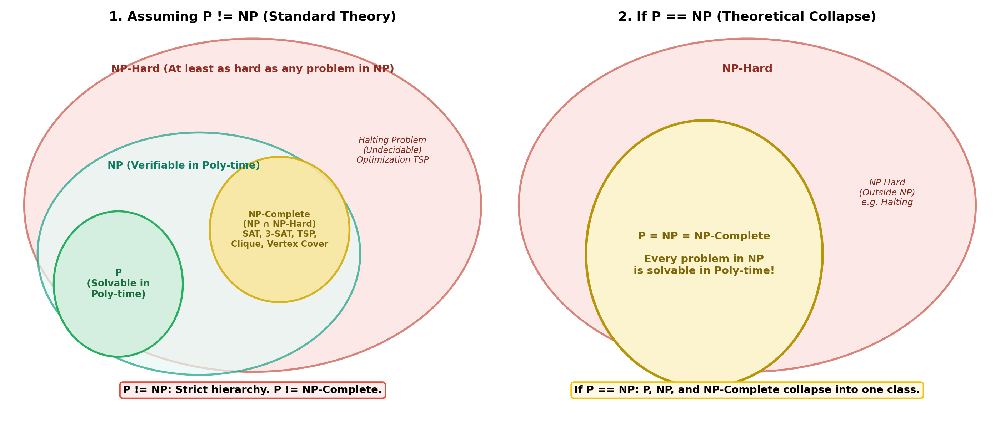
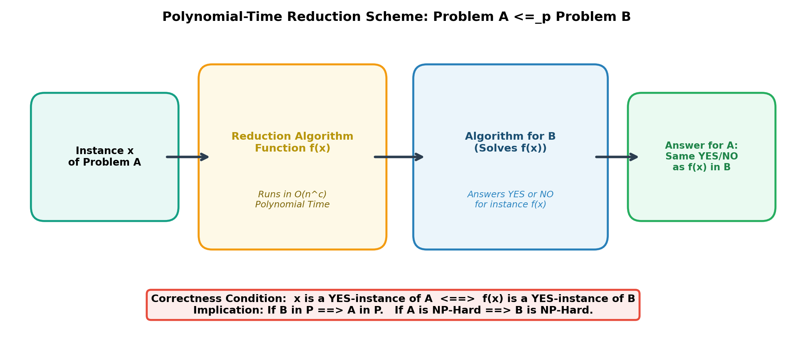
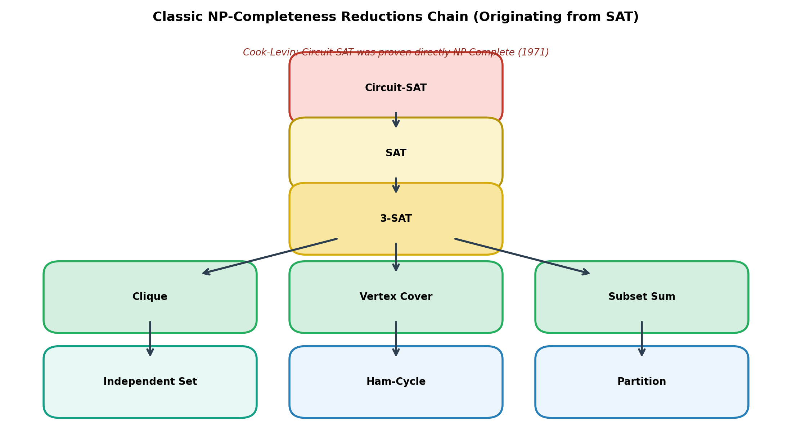
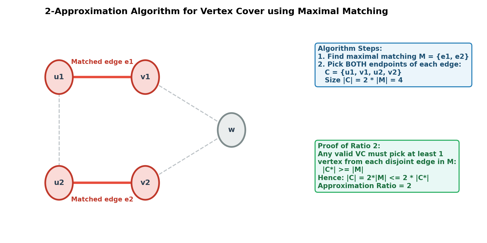
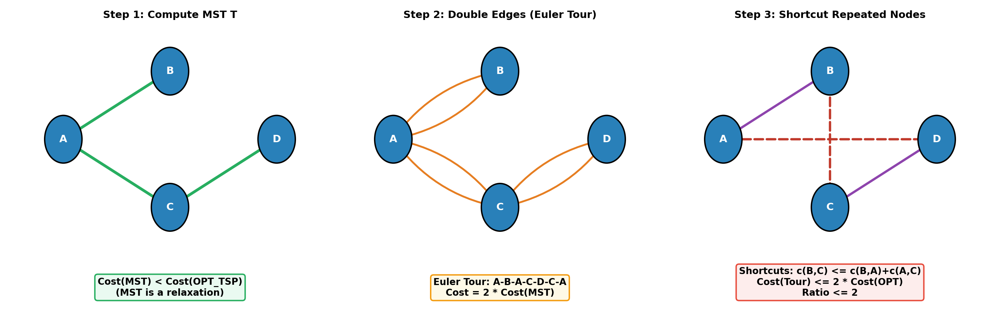

# DAA Unit VI: Introduction to Theory of NP-Completeness — Visual Diagrams & Drawing Guide

**Course Code**: CS3212 | **Subject**: Design and Analysis of Algorithms  
**Generated Images**: High-resolution standalone PNG files located in `AI GENERATED/DAA/Diagrams/`.  
Use this guide to review visual concepts and practice drawing diagrams by hand in your 2-hour exam.

---

## Diagram 1: Complexity Classes Hierarchy (P ≠ NP vs P = NP)

**File**: `DAA_Unit6_Diagram1_ComplexityClasses.png`



### Exam ASCII Redraw Format (Assuming P ≠ NP):
```text
+-----------------------------------------------------------+
|                        NP-HARD                            |
|                                         Halting Problem   |
|   +---------------------------------+   Optimization TSP  |
|   |               NP                |                     |
|   |                                 |                     |
|   |   +---------+     +---------+   |                     |
|   |   |    P    |     |   NPC   |   |                     |
|   |   | (Solv-  |     | (Hardest|   |                     |
|   |   |  able)  |     |  in NP) |   |                     |
|   |   |         |     |         |   |                     |
|   |   | Dijkstra|     | 3-SAT,  |   |                     |
|   |   | Kruskal |     | Vertex  |   |                     |
|   |   | MaxFlow |     | Cover   |   |                     |
|   |   +---------+     +---------+   |                     |
|   |                                 |                     |
|   +---------------------------------+                     |
+-----------------------------------------------------------+
Key Properties:
1. P is inside NP (P ⊆ NP).
2. NP-Complete = NP ∩ NP-Hard.
3. If ANY problem in NPC is in P ==> P = NP (entire diagram collapses!).
```

---

## Diagram 2: Polynomial Reduction Architecture (A ≤_p B)

**File**: `DAA_Unit6_Diagram2_PolynomialReduction.png`



### Exam ASCII Redraw Format:
```text
Instance x of A                      Instance f(x) of B
   +---------+      Reduction f         +---------+
   | Input x | =======================> |  f(x)   |
   +---------+      Time: O(n^c)        +----+----+
                                             |
                                             v
                                        +----+----+
                                        | Decider |
                                        |  for B  |
                                        +----+----+
                                             |
                                             v
                             Same YES / NO output for x in A!

Rule:  x is YES for A  <===>  f(x) is YES for B
- If B in P      ===> A in P      (easy transfers right-to-left)
- If A is NP-Hard ===> B is NP-Hard (hardness transfers left-to-right)
```

---

## Diagram 3: Classic NP-Completeness Reduction Chain

**File**: `DAA_Unit6_Diagram3_ReductionChainTree.png`



### Exam ASCII Redraw Format:
```text
               [ Circuit-SAT ]
                      |
                      v  (Cook-Levin Theorem, 1971)
                   [ SAT ]
                      |
                      v  (Karp, 1972)
                  [ 3-SAT ]
                 /    |    \
                /     |     \
               v      v      v
          [ Clique ]  |    [ Subset Sum ]
             |        v           |
   (Complement) [ Vertex Cover ]  v
             |        |    [ Partition ]
             v        v
     [ Indep Set ]  [ Ham-Cycle ]
                      |
                      v
                   [ TSP ]
```

---

## Diagram 4: 2-Approximation for Vertex Cover (Maximal Matching)

**File**: `DAA_Unit6_Diagram4_ApproxVertexCover.png`



### Exam ASCII Redraw Format:
```text
       (u1) ============ (v1)      <-- Matched edge e1
        |                 \
        |                  \
        |                   (w)
        |                  /
        |                 /
       (u2) ============ (v2)      <-- Matched edge e2

1. Maximal Matching M = { (u1, v1), (u2, v2) }.
2. Cover C selects BOTH endpoints of every matched edge:
   C = { u1, v1, u2, v2 }
   |C| = 2 * |M| = 4.
3. Any optimal cover C* must pick at least 1 vertex per matched edge:
   |C*| >= |M| = 2.
4. Ratio: |C| = 2 * |M| <= 2 * |C*|  ==>  Ratio = 2.
```

---

## Diagram 5: 2-Approximation for Metric TSP (MST Doubling + Shortcuts)

**File**: `DAA_Unit6_Diagram5_MetricTSP2Approx.png`



### Exam ASCII Redraw Format:
```text
Step 1: Compute MST T            Step 2: Double Edges (Euler)      Step 3: Shortcut Repeats
       (B)                              (B)                              (B)
      /                                //                               /   \
     /                                //                               /     \
   (A)                              (A)                              (A)      (C)
     \                                \\                               \     /
      \                                \\                               \   /
       (C) --- (D)                      (C) === (D)                      (D)

Cost(MST) < Cost(OPT_TSP)         Cost(Euler) = 2 * Cost(MST)      Triangle Inequality:
                                                                    Cost(Tour) <= Cost(Euler) < 2*Cost(OPT)
```
