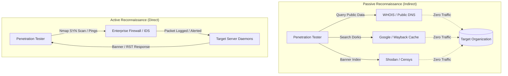
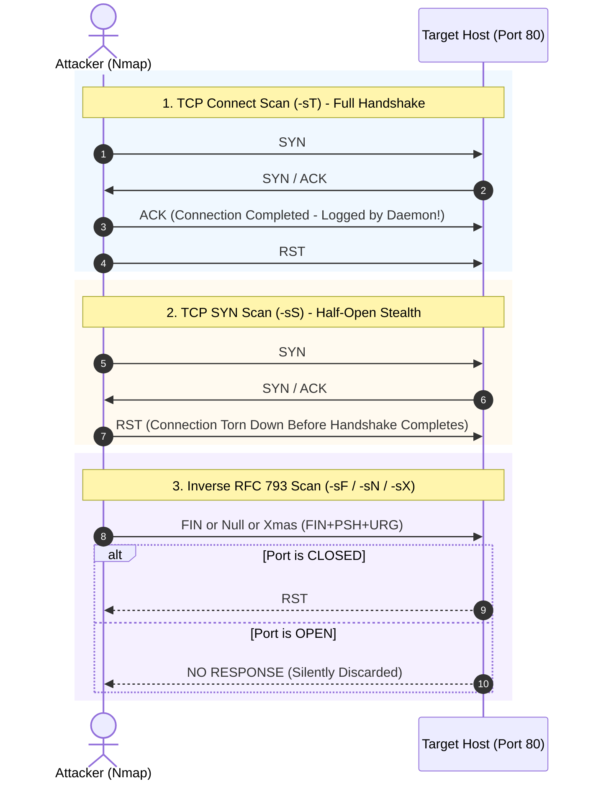
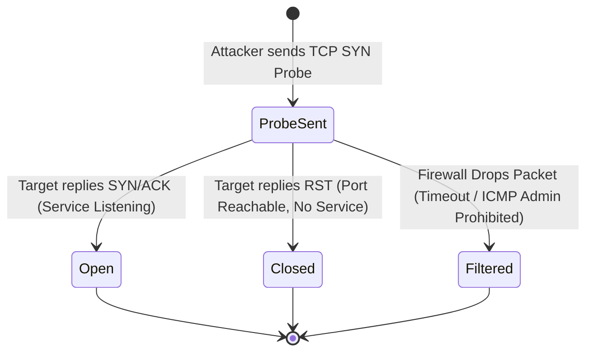
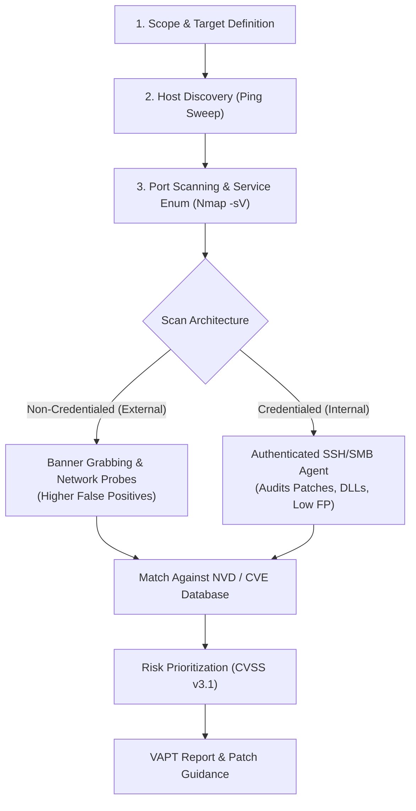

# Ethical Hacking (EH) — Unit II Exam Diagrams & Visual Redraw Guides
**Course**: Ethical Hacking (MD***) | **VIT Pune**  
**Unit II**: Footprinting, Reconnaissance and Scanning

---

## Diagram 1: Passive vs Active Reconnaissance Architecture

### Standalone Image Reference


### ASCII Redraw Sketch (For 30-Second Exam Answer Sheet Reproduction)
```
+------------------------------------+    +------------------------------------+
|       PASSIVE RECONNAISSANCE       |    |       ACTIVE RECONNAISSANCE        |
|          (Zero Contact)            |    |          (Direct Probing)          |
+------------------------------------+    +------------------------------------+
|                                    |    |                                    |
|  [Tester] ──> [WHOIS / DNS DB]     |    |  [Tester] ──── SYN Probes ─────>   |
|     │                               |    |     │     <── SYN/ACK, RST ───     |
|     ├───> [Google / Cache]         |    |     ▼                              |
|     └───> [Shodan / Censys]        |    |  [Firewall / IDS]                  |
|                                    |    |     │ (Logs & Alerts Triggered!)   |
|                 X                  |    |     ▼                              |
|  [Target Enterprise System]        |    |  [Target Web / DB Server]          |
|  * Firewalls record ZERO probes!   |    |  * Directly interacts with ports   |
+------------------------------------+    +------------------------------------+
```

### Mermaid Diagram


### 30-Second Exam Redraw Guide
* Draw two side-by-side rectangular boxes labeled **Passive** and **Active**.
* On the left, draw an arrow from `Tester` pointing to `WHOIS / Shodan / DNS`, and draw a dashed line with a big `X` to the `Target` indicating zero packets hit the target.
* On the right, draw a bidirectional arrow between `Tester` and `Target Firewall`, with a note: `Packets logged by IDS/WAF`.

---

## Diagram 2: DNS Zone Transfer (AXFR) Mechanism & Exploit

### Standalone Image Reference


### ASCII Redraw Sketch
```
+---------------------------------------------------------------------------------+
|                      DNS ZONE TRANSFER (AXFR) ARCHITECTURE                      |
+---------------------------------------------------------------------------------+
|                                                                                 |
|   [Primary Master DNS]  <──────── AXFR Query (TCP 53) ───────  [Secondary DNS]   |
|   (ns1.target.com)      ──────── Full Zone DB Transfer ────>  (Legitimate)      |
|           │                                                                     |
|           │ (VULNERABILITY: allow-transfer { any; };)                           |
|           │                                                                     |
|           ▲                                                                     |
|           │ 1. dig @ns1.target.com target.com AXFR (TCP 53)                     |
|           ▼ 2. LEAKED: All Subdomains, Internal IPs, VPNs                       |
|   [Attacker / Tester]                                                           |
|                                                                                 |
+---------------------------------------------------------------------------------+
```

### Mermaid Diagram
```mermaid
sequenceDiagram
    autonumber
    actor Attacker as Rogue Attacker / Tester
    participant Master as Master DNS (ns1.target.com)
    participant Slave as Secondary DNS (ns2.target.com)

    Note over Master,Slave: Legitimate Zone Replication
    Slave->>Master: AXFR Request over TCP Port 53
    Master->>Slave: Synchronizes Zone Records (A, MX, CNAME)

    Note over Attacker,Master: Exploitation (Misconfigured Access Control)
    Attacker->>Master: dig @ns1.target.com target.com AXFR
    alt allow-transfer { any; };
        Master->>Attacker: Dumps Entire Domain Zone (Internal Subdomains, VPN, DBs)
    else allow-transfer { 192.168.1.5; }; (Hardened)
        Master-->>Attacker: Transfer Failed: Refused (RCODE 5)
    end
```

### 30-Second Exam Redraw Guide
* Draw Master DNS in the center and Secondary DNS on the right with a two-way sync arrow labeled `AXFR (TCP 53)`.
* Draw Attacker at the bottom sending an unauthorized `dig AXFR` command.
* Label the response: `allow-transfer { any; }` results in total disclosure of internal subdomains and IP addresses. Write the defense below: `allow-transfer { trusted_ip; };` and `TSIG keys`.

---

## Diagram 3: Nmap Port Scanning Packet Exchange Mechanics

### Standalone Image Reference


### ASCII Redraw Sketch
```
  1. TCP Connect (-sT)            2. TCP SYN Stealth (-sS)         3. Inverse Scans (-sF,-sX,-sN)
  Client        Target            Client        Target             Client         Target
    │             │                 │             │                  │              │
    ├── SYN ────> │                 ├── SYN ────> │                  ├── FIN/Null ─>│
    │<──SYN/ACK──┤                 │<──SYN/ACK──┤                  │              │
    ├── ACK ────> │ (Established)   └── RST ────> │ (Aborted!)       │  [If CLOSED] │
    └── RST ────> │ (Teardown)                                       │<── RST ──────┤
                                                                     │              │
  * Logged in App Logs            * Never logged in App Logs         │  [If OPEN]   │
  * No root needed                * Requires root/admin              └── NO REPLY ──┘
```

### Mermaid Diagram


### 30-Second Exam Redraw Guide
* Draw 3 vertical interaction timelines:
  1. **Connect**: 4 arrows (`SYN` $\rightarrow$, $\leftarrow$ `SYN/ACK`, `ACK` $\rightarrow$, `RST` $\rightarrow$). Add note: "Logged in app logs".
  2. **SYN**: 3 arrows (`SYN` $\rightarrow$, $\leftarrow$ `SYN/ACK`, `RST` $\rightarrow$). Add note: "Half-open, root required".
  3. **Inverse**: 1 arrow probe $\rightarrow$. If closed $\leftarrow$ `RST`; if open $\rightarrow$ `No Response` (RFC 793).

---

## Diagram 4: Port States & Firewall Interaction

### Standalone Image Reference


### ASCII Redraw Sketch
```
+-----------+--------------------+--------------------------------------------------+
|   STATE   |  PROBE (Attacker)  |  TARGET / FIREWALL BEHAVIOR & RESPONSE           |
+-----------+--------------------+--------------------------------------------------+
|   OPEN    | ──── TCP SYN ────> | [Target Host] Application listening              |
|           | <── TCP SYN/ACK ── | Returns SYN/ACK                                  |
+-----------+--------------------+--------------------------------------------------+
|  CLOSED   | ──── TCP SYN ────> | [Target Host] No daemon listening                |
|           | <─── TCP RST ───── | Kernel responds with RST                         |
+-----------+--------------------+--------------------------------------------------+
| FILTERED  | ──── TCP SYN ────> | [Firewall] Intercepts & Drops Packet             |
|           | <── (No Reply) ─── | Probe times out OR returns ICMP Type 3 Code 13   |
+-----------+--------------------+--------------------------------------------------+
```

### Mermaid Diagram


### 30-Second Exam Redraw Guide
* Draw a 3-row table or state diagram showing the 3 Nmap states:
  * **Open**: `SYN` $\rightarrow$ Target $\rightarrow$ `SYN/ACK` $\rightarrow$ Attacker.
  * **Closed**: `SYN` $\rightarrow$ Target $\rightarrow$ `RST` $\rightarrow$ Attacker.
  * **Filtered**: `SYN` $\rightarrow$ [Firewall] $\rightarrow$ Dropped silently (Timeout) or ICMP Type 3 Code 13 error.

---

## Diagram 5: Vulnerability Assessment (VA) Lifecycle & Scan Types

### Standalone Image Reference


### ASCII Redraw Sketch
```
[ Scope Definition ] ──> [ Host Discovery ] ──> [ Port & Service Detection ]
                                                          │
                                                          ▼
                                            [ Vulnerability Scanner ]
                                            (Nessus / OpenVAS)
                                             ┌────────────┴────────────┐
                                             ▼                         ▼
                                   [Non-Credentialed]         [Credentialed]
                                   * External probe           * SSH / SMB Login
                                   * Banner matching          * Audits DLLs & Reg
                                   * High False Positives     * Zero False Pos
                                             └────────────┬────────────┘
                                                          ▼
                                            [ CVE / NVD Database Match ]
                                                          │
                                                          ▼
                                            [ CVSS Score & Reporting ]
```

### Mermaid Diagram


### 30-Second Exam Redraw Guide
* Draw a 5-step horizontal or vertical chain: `Scope` $\rightarrow$ `Discovery` $\rightarrow$ `Service Enum` $\rightarrow$ `Vulnerability Scanner` $\rightarrow$ `CVE Database Matching` $\rightarrow$ `Report`.
* Under `Vulnerability Scanner`, branch into two boxes: `Credentialed` (SSH/SMB login, audits files, low false positives) vs `Non-Credentialed` (external probe, checks banners, higher false positives).
