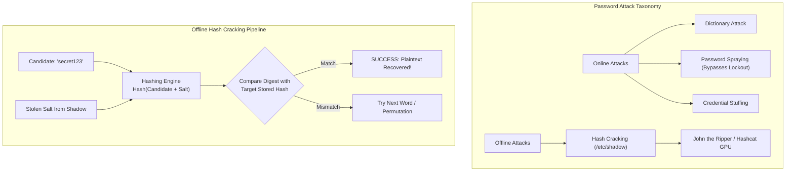
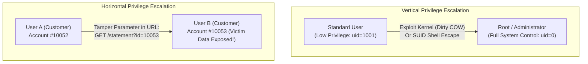
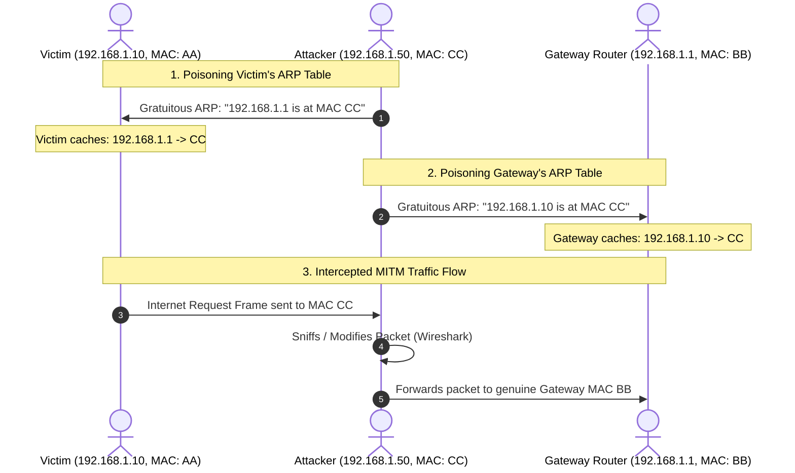
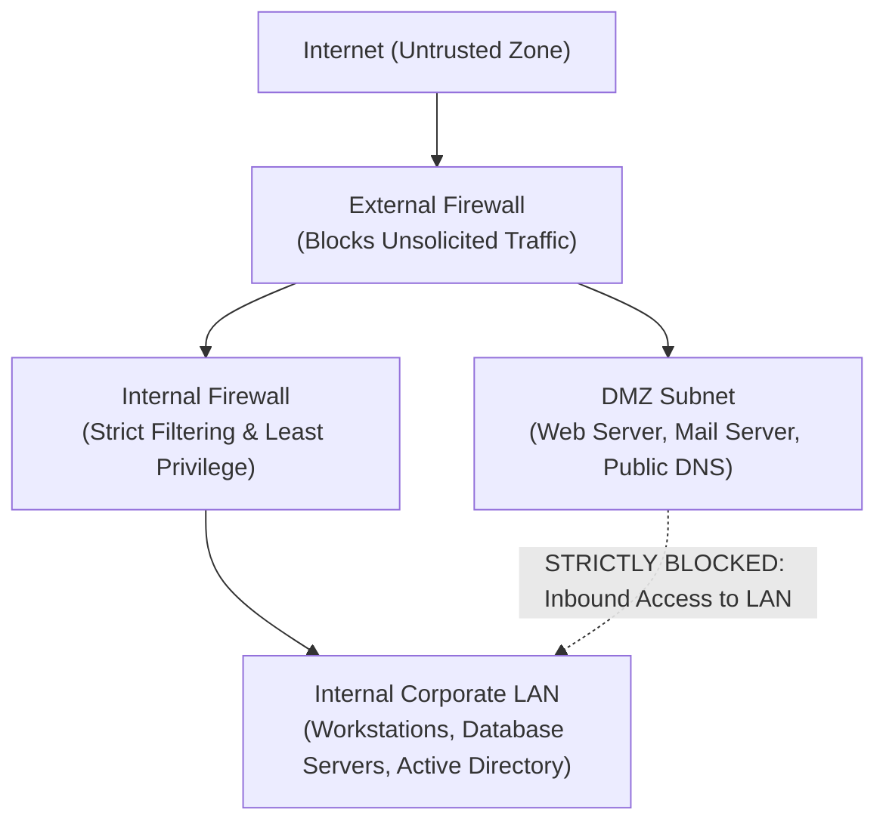

```mermaid
flowchart LR
    subgraph IDS ["1. Intrusion Detection System (Passive)"]
        R1["Router"] -->|"Live Traffic"| SW1["Switch"]
        SW1 -.->|"SPAN / Mirror Port Copy"| IDS_BOX["Passive IDS\n(Snort / Zeek)"]
        IDS_BOX -->|"Alert Triggered"| SIEM["SIEM / SOC Console\n(Traffic is NOT interrupted)"]
    end

    subgraph IPS ["2. Intrusion Prevention System (Inline)"]
        R2["Router"] -->|"Physical Wire"| IPS_BOX["Inline IPS"]
        IPS_BOX -->|"Clean Traffic"| SW2["Internal Switch"]
        IPS_BOX -.->|"Malicious Signature Detected"| DROP["PACKET DROPPED!\nSends TCP RST"]
    end
```

# Ethical Hacking (EH) — Unit III Exam Diagrams & Visual Redraw Guides
**Course**: Ethical Hacking (MD***) | **VIT Pune**  
**Unit III**: System Hacking and Network Security

---

## Diagram 1: Password Attack Taxonomy & Hash Cracking Pipeline

### Standalone Image Reference


### ASCII Redraw Sketch (For 30-Second Exam Answer Sheet Reproduction)
```
+---------------------------------------------------------------------------------+
|                        PASSWORD ATTACK TAXONOMY & FLOW                          |
+-----------------------------------+---------------------------------------------+
| ONLINE ATTACKS (Live Network)     | OFFLINE ATTACKS (Stolen Hashes)             |
| * Brute Force / Dictionary        | * Target: /etc/shadow, SAM Database         |
| * Password Spraying (1 pass->many)| * Advantage: No lockout, GPU speed          |
| * Credential Stuffing             | * Tools: John the Ripper (CPU), Hashcat(GPU)|
+-----------------------------------+---------------------------------------------+
| CRACKING PIPELINE:                                                              |
| [Candidate Word] + [Stolen Salt] ──> [Slow Hash: bcrypt / Argon2]               |
|                                                     │                           |
|                                                     ▼                           |
| [Stolen Target Hash] ────────── Comparator ─────────┤                           |
|                                      │                                          |
|                          Match? ─────┴─────> YES: Password Cracked!             |
|                                      └─────> NO: Next Candidate                 |
+---------------------------------------------------------------------------------+
```

### Mermaid Diagram


### 30-Second Exam Redraw Guide
* Draw a 2-column box: Left = **Online** (Password Spraying, Credential Stuffing, lockout risk); Right = **Offline** (Stolen hashes, John/Hashcat, no lockout).
* Underneath, draw the comparator: `Candidate` + `Salt` $\rightarrow$ `Hash Engine` $\rightarrow$ Match box comparing with `Stored Hash` $\rightarrow$ Yes/No.

---

## Diagram 2: Vertical vs Horizontal Privilege Escalation

### Standalone Image Reference


### ASCII Redraw Sketch
```
+------------------------------------+    +------------------------------------+
|   VERTICAL PRIVILEGE ESCALATION    |    |  HORIZONTAL PRIVILEGE ESCALATION   |
|     (Privilege Level Elevation)    |    |      (Lateral Identity Shift)      |
+------------------------------------+    +------------------------------------+
|                                    |    |                                    |
|   [ ROOT / ADMINISTRATOR ]         |    |   [ USER A ] ──── IDOR ────> [ USER B ]
|   (Full Kernel / SYSTEM Rights)    |    |   (Attacker)                 (Victim)  |
|                 ▲                  |    |   ID: #10052                 ID: #10053|
|                 │ EXPLOITATION:    |    |                                    |
|                 │ * Kernel Bug     |    |   * Same Privilege Level           |
|                 │ * SUID Escapes   |    |   * Broken Object Level Auth       |
|                 │ * Sudoers Flaw   |    |   * Direct Object Reference Tamper |
|   [ STANDARD USER (www-data) ]     |    |                                    |
+------------------------------------+    +------------------------------------+
```

### Mermaid Diagram


### 30-Second Exam Redraw Guide
* On the left, draw an upward vertical arrow from a box `Standard User` to `Root/Admin`. Label the arrow: `Kernel exploits, SUID binaries, Insecure sudo`.
* On the right, draw a horizontal arrow between two boxes at the same level: `User A (#101)` $\rightarrow$ `User B (#102)`. Label: `IDOR / Broken Object Level Auth`.

---

## Diagram 3: ARP Spoofing & Man-in-the-Middle (MITM) Flow

### Standalone Image Reference


### ASCII Redraw Sketch
```
                      +-----------------------------+
                      |   ATTACKER (192.168.1.50)   |
                      |     MAC: CC:CC:CC:CC:CC:CC  |
                      +-----------------------------+
                        ▲                         ▲
       Forged ARP Reply |                         | Forged ARP Reply
  "192.168.1.1 is at CC"|                         | "192.168.1.10 is at CC"
                        ▼                         ▼
+-----------------------------+             +-----------------------------+
|    VICTIM (192.168.1.10)    |             |   GATEWAY (192.168.1.1)     |
|     MAC: AA:AA:AA:AA:AA:AA  |             |     MAC: BB:BB:BB:BB:BB:BB  |
+-----------------------------+             +-----------------------------+
| Poisoned Cache:             |             | Poisoned Cache:             |
| 192.168.1.1 -> CC:CC:CC     |             | 192.168.1.10 -> CC:CC:CC    |
+-----------------------------+             +-----------------------------+
      (Outbound Traffic) ────► [Attacker] ────► (Forwarded to Gateway)
```

### Mermaid Diagram


### 30-Second Exam Redraw Guide
* Draw a triangle with `Attacker` at top, `Victim` at bottom-left, and `Gateway` at bottom-right.
* Draw dashed arrows from `Attacker` to both Victim and Gateway labeled: `Forged Gratuitous ARP Reply`.
* Show Victim's ARP table mapping the gateway IP to the attacker's MAC address (`CC:CC:CC`).
* Write the primary switch defense below: `Dynamic ARP Inspection (DAI) + DHCP Snooping`.

---

## Diagram 4: Firewall Generations & DMZ Architecture

### Standalone Image Reference


### ASCII Redraw Sketch
```
                                [ INTERNET ]
                                     │
                                     ▼
                            [ External Firewall ]
                                     │
                ┌────────────────────┴────────────────────┐
                ▼                                         ▼
        [ DMZ Subnet ]                         [ Internal Firewall ]
   (Web, Mail, Public DNS)                                │
   * Accessible to Internet                               ▼
   * No access to internal DB                   [ Trusted Corporate LAN ]
                                                (Workstations, DBs, AD)
```

### Mermaid Diagram


### 30-Second Exam Redraw Guide
* Draw `Internet` $\rightarrow$ `External Firewall`.
* Branch down into two zones: Left = `DMZ Subnet` (Web/Mail/DNS servers); Right = `Internal Firewall` $\rightarrow$ `Internal LAN` (Workstations, Databases).
* Put an `X` on any direct line from DMZ into the Internal LAN to show network isolation.

---

## Diagram 5: IDS vs IPS Deployment & Detection Paradigms

### Standalone Image Reference


### ASCII Redraw Sketch
```
1. IDS (Passive, Out-of-Band)               2. IPS (Active, In-Line)
                                            
   [Router] ────── Live Traffic ────> [Switch]  [Router] ──> [ INLINE IPS ] ──> [Switch]
                                         │                       │
                                   SPAN /│ (Mirror Copy)         ▼ (Threat Detected!)
                                   TAP   ▼                  DROPS PACKET &
                                   [ PASSIVE IDS ]          RESETS TCP (RST)
                                         │
                                         ▼
                                   [ SIEM Alert ]
                                   (Zero packet drops!)
```

### Mermaid Diagram


### 30-Second Exam Redraw Guide
* Draw side-by-side sketches:
  * Left: `Router` $\rightarrow$ `Switch`. A dashed arrow branches down from `Switch (SPAN port)` to `IDS` $\rightarrow$ `Alert to SIEM`. Note: "Out-of-band, zero latency".
  * Right: `Router` $\rightarrow$ `Inline IPS` $\rightarrow$ `Switch`. Note: "In-line physical path, drops packets, sends TCP RST".
