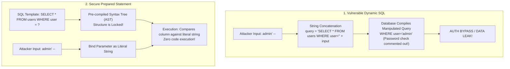
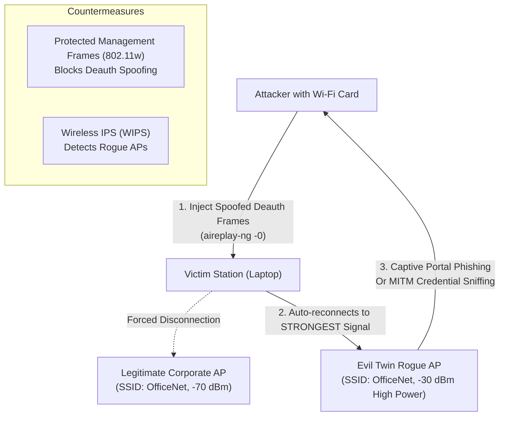

```mermaid
flowchart TD
    subgraph Reflected ["1. Reflected XSS (Non-Persistent)"]
        R_ATK["Attacker crafts link:\nsite.com/search?q=<script>"] --> R_VIC["Victim clicks link"]
        R_VIC --> R_SRV["Web Server"]
        R_SRV -->|"Reflects unencoded q param"| R_VIC
        R_VIC -->|"Script executes in browser"| R_STEAL["Cookie Stolen!"]
    end

    subgraph Stored ["2. Stored XSS (Persistent)"]
        S_ATK["Attacker posts comment with <script>"] --> S_DB[("Database")]
        S_DB -->|"Stored permanently"| S_APP["Web App"]
        S_APP -->|"Served to ALL visitors"| S_VIC["Victim 1, 2, 3... Browsers Execute!"]
    end

    subgraph DOM ["3. DOM-Based XSS (Client-Side)"]
        D_URL["URL Fragment: site.com/page#<script>"] --> D_DOM["Client Browser DOM"]
        D_DOM -->|"Source: location.hash\nSink: element.innerHTML"| D_EXEC["Script Executes Locally\n(Server sees nothing!)"]
    end
```

# Ethical Hacking (EH) — Unit IV Exam Diagrams & Visual Redraw Guides
**Course**: Ethical Hacking (MD***) | **VIT Pune**  
**Unit IV**: Web Application and Wireless Security

---

## Diagram 1: SQL Injection Mechanics & Prepared Statement Defense

### Standalone Image Reference


### ASCII Redraw Sketch (For 30-Second Exam Answer Sheet Reproduction)
```
+---------------------------------------------------------------------------------+
|               SQL INJECTION (Vulnerable) vs PREPARED STATEMENTS (Secure)        |
+---------------------------------------------------------------------------------+
| 1. VULNERABLE DYNAMIC STRING CONCATENATION:                                     |
|    Code:  "SELECT * FROM users WHERE user = '" + input + "' AND pass = '...'"   |
|    Input: admin' --                                                             |
|    Result: SELECT * FROM users WHERE user = 'admin' --' AND pass = ''           |
|    (Comment operator '--' wipes out password validation -> Auth Bypass!)        |
+---------------------------------------------------------------------------------+
| 2. SECURE PARAMETERIZED PREPARED STATEMENT:                                     |
|    Code:  "SELECT * FROM users WHERE user = ? AND pass = ?"                     |
|    Bind:  stmt.setString(1, input_user);                                        |
|    Result: SQL grammar is compiled FIRST. Input is treated as a LITERAL STRING.|
|    (Input "admin' --" is searched as a literal username -> Zero execution!)     |
+---------------------------------------------------------------------------------+
```

### Mermaid Diagram


### 30-Second Exam Redraw Guide
* Draw two panels:
  * Top/Left: Dynamic concatenation query showing `admin' --` breaking out of quotes and commenting out the rest of the query with `--`.
  * Bottom/Right: Prepared statement `SELECT * FROM users WHERE user = ?` showing the `?` placeholder pre-compiled, treating the input strictly as a harmless literal scalar.

---

## Diagram 2: Cross-Site Scripting (XSS) Typology

### Standalone Image Reference


### ASCII Redraw Sketch
```
  1. REFLECTED XSS (Type I)       2. STORED XSS (Type II)         3. DOM-BASED XSS (Type 0)
                                                                 
  [Attacker]                     [Attacker]                     [Attacker]
      │                              │                              │
      ├── Poisoned URL ──► [Victim]  ├── Post Comment ──► [DB]      └── #payload ──► [Victim]
      │                              │                      │                            │
      ▼                              ▼                      ▼                            ▼
  [Server]                       [Server] ──► [Victim 1, 2]     [Client JS: innerHTML]
  Reflects query parameter       Serves stored payload to       Executes locally in DOM;
  immediately into HTML.         ALL future site visitors.      Server NEVER sees payload!
```

### Mermaid Diagram


### 30-Second Exam Redraw Guide
* Draw 3 vertical columns:
  * **Reflected**: Link with `<script>` clicked by victim $\rightarrow$ Server reflects in output $\rightarrow$ Browser executes.
  * **Stored**: Attacker posts payload $\rightarrow$ Stored in Database $\rightarrow$ Executed by every future visitor.
  * **DOM**: Payload in URL `#hash` $\rightarrow$ Processed by `innerHTML` on client $\rightarrow$ Server never sees it.

---

## Diagram 3: CSRF Attack & Anti-CSRF Token Defense

### Standalone Image Reference


### ASCII Redraw Sketch
```
+---------------------------------------------------------------------------------+
|                 CROSS-SITE REQUEST FORGERY (CSRF) & DEFENSE                     |
+---------------------------------------------------------------------------------+
| 1. ATTACK (Vulnerable):                                                         |
|    [Victim Browser] (Authenticated with bank.com; cookie stored)                |
|           │                                                                     |
|           ▼ (Visits malicious site)                                             |
|    [evil.com] ── Hidden Auto-POST: /transfer?to=Attacker&$10000 ──► [bank.com]  |
|    * Browser AUTOMATICALLY attaches bank.com session cookie!                    |
|    * Transfer executed without victim knowledge!                                |
+---------------------------------------------------------------------------------+
| 2. DEFENSE (Anti-CSRF Synchronizer Token):                                      |
|    * bank.com generates unique, unpredictable token in session.                 |
|    * Embedded in form: <input type="hidden" name="csrf" value="X9aB2..." />     |
|    * evil.com CANNOT read or forge token due to Same-Origin Policy (SOP).       |
|    * Token missing or invalid? Server REJECTS the request!                      |
+---------------------------------------------------------------------------------+
```

### Mermaid Diagram
```mermaid
sequenceDiagram
    autonumber
    actor V as Victim Browser
    participant B as Vulnerable Bank (bank.com)
    participant E as Attacker Site (evil.com)

    Note over V,B: Victim is logged in (session cookie in browser)
    V->>E: Victim visits evil.com (phishing/ad)
    Note over E: evil.com contains hidden auto-submitting form
    E->>B: POST /transfer (toAccount=Attacker, amount=10000)
    Note over V,B: Browser automatically attaches bank.com cookie!
    alt Without Anti-CSRF Token (Vulnerable)
        B->>B: Validates cookie; executes transfer!
    else With Synchronizer Token (Defended)
        B-->>V: REJECTED 403 Forbidden: Missing or Invalid CSRF Token
    end
```

### 30-Second Exam Redraw Guide
* Draw `Victim Browser` in the center, `evil.com` on the left, and `bank.com` on the right.
* Show `evil.com` submitting a forged transfer form to `bank.com`, with the browser automatically attaching the cookie.
* Write the two primary defenses: **Anti-CSRF Synchronizer Token** and **`SameSite=Strict` Cookie Flag**.

---

## Diagram 4: Wi-Fi Security Protocol Evolution & 4-Way Handshake

### Standalone Image Reference


### ASCII Redraw Sketch
```
+---------------------------------------------------------------------------------+
|                        WI-FI SECURITY PROTOCOL EVOLUTION                        |
+---------------------------------------------------------------------------------+
| WEP (1997)   : RC4 stream cipher + 24-bit weak IV. Completely broken in seconds!|
| WPA (2003)   : RC4 + TKIP + Michael MIC. Deprecated interim patch.              |
| WPA2 (2004)  : AES-CCMP block cipher. 4-Way Handshake vulnerable to offline dict|
| WPA3 (2018)  : AES-GCM + SAE (Dragonfly). Forward secrecy; resists offline dict|
+---------------------------------------------------------------------------------+
| WPA2 4-WAY HANDSHAKE (EAPOL):                                                   |
|   Client (Supplicant)                            Access Point (Authenticator)   |
|         │                                                     │                 |
|         │ <─────────── 1. ANonce (AP Nonce) ─────────────────┤                 |
|         ├───────────── 2. SNonce + MIC (Derives PTK) ────────>│                 |
|         │ <─────────── 3. GTK + MIC (Installs Keys) ─────────┤                 |
|         ├───────────── 4. ACK (Handshake Complete) ──────────>│                 |
+---------------------------------------------------------------------------------+
```

### Mermaid Diagram
```mermaid
sequenceDiagram
    autonumber
    actor C as Client Station (Supplicant)
    actor AP as Access Point (Authenticator)

    Note over C,AP: WPA2 4-Way Handshake (Deriving PTK from PSK)
    AP->>C: 1. ANonce (Random Nonce from AP)
    Note over C: Client generates SNonce; derives PTK = PRF(PSK, ANonce, SNonce, MACs)
    C->>AP: 2. SNonce + Message Integrity Code (MIC)
    Note over AP: AP derives PTK; verifies MIC matches PSK
    AP->>C: 3. Group Temporal Key (GTK) + MIC
    C->>AP: 4. Confirmation ACK (Handshake Complete)
    Note over C,AP: Attacker sniffing EAPOL frames can crack PSK offline!
```

### 30-Second Exam Redraw Guide
* Draw a quick 4-protocol evolution table: `WEP (RC4/24-bit IV - Broken)` $\rightarrow$ `WPA (TKIP)` $\rightarrow$ `WPA2 (AES-CCMP / 4-way handshake)` $\rightarrow$ `WPA3 (AES-GCM / SAE Dragonfly)`.
* Draw the 4 arrows of the handshake: 1. `ANonce` $\leftarrow$, 2. `SNonce + MIC` $\rightarrow$, 3. `GTK + MIC` $\leftarrow$, 4. `ACK` $\rightarrow$.

---

## Diagram 5: Wireless Attack Vectors (Evil Twin & Deauthentication)

### Standalone Image Reference


### ASCII Redraw Sketch
```
+---------------------------------------------------------------------------------+
|                     WIRELESS THREAT ARCHITECTURE: EVIL TWIN                     |
+---------------------------------------------------------------------------------+
|                                                                                 |
|   [ Genuine AP ] (SSID: "Corporate", Signal: -65 dBm)                           |
|         │                                                                       |
|         ▲ (1. Attacker sends spoofed Deauth frames: aireplay-ng -0)             |
|         │                                                                       |
|   [ Attacker ] ──► Spoofs Deauth ──► [ Victim Station ]                         |
|   [ Evil Twin AP ] (Cloned SSID: "Corporate", Signal: -30 dBm STRONGER!)        |
|         ▲                                                                       |
|         │ (2. Victim disconnects from genuine AP and connects to Evil Twin!)    |
|         └── Attacker sniffs traffic & serves fake captive portal for creds.     |
|                                                                                 |
| DEFENSE: WPA3 Protected Management Frames (PMF 802.11w) + WIPS Monitoring       |
+---------------------------------------------------------------------------------+
```

### Mermaid Diagram


### 30-Second Exam Redraw Guide
* Draw `Genuine AP` on the left and `Evil Twin AP` on the right (both labeled with the same SSID `OfficeNet`).
* Draw `Victim Station` in the middle.
* Show an arrow injecting `Deauth frames` to disconnect the victim, followed by an arrow connecting the victim to the stronger `Evil Twin AP`.
* Label the defense: `WPA3 Protected Management Frames (PMF)`.
