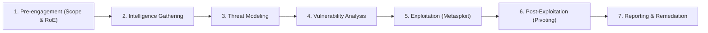
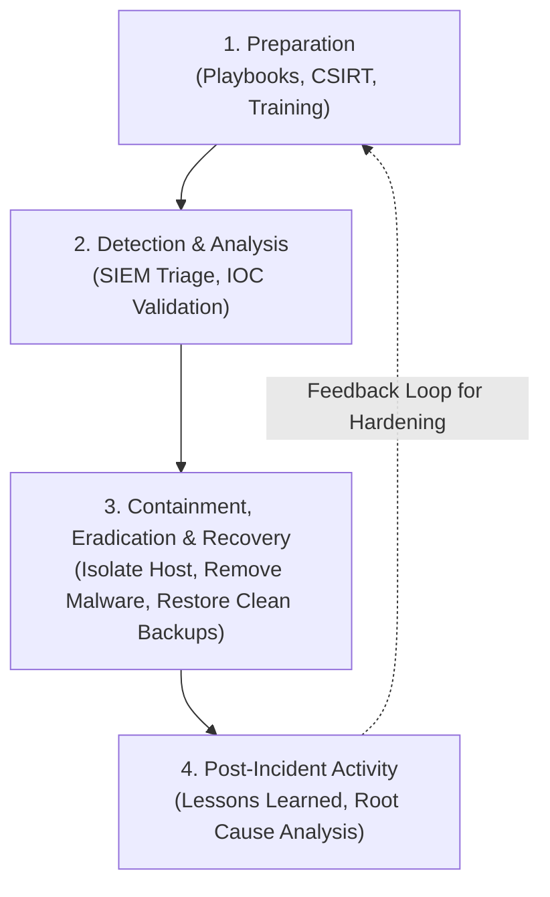
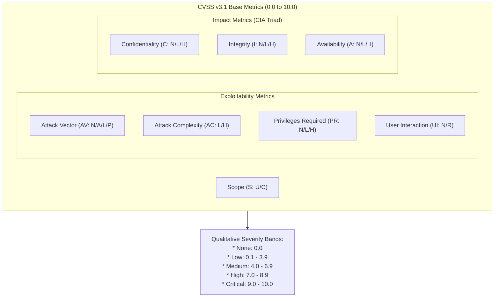
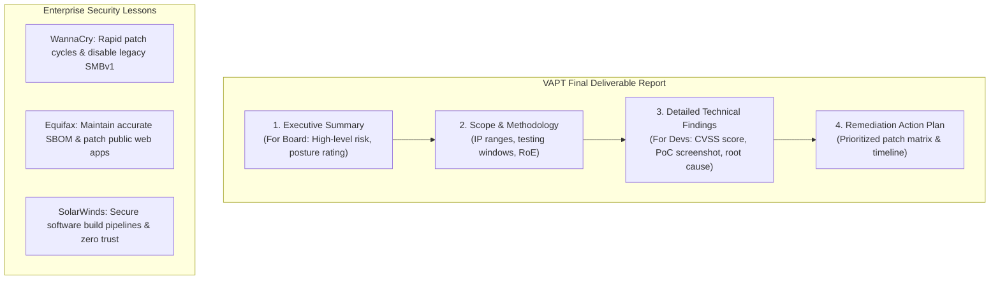

```mermaid
flowchart LR
    subgraph Sources ["Distributed Log Sources"]
        DC["Domain Controller\n(Event ID 4625 Failed Logon)"]
        FW["Firewall & Router Logs\n(Dropped Probes, Denied ACLs)"]
        WEB["Web & DB Server Logs\n(HTTP 500, Union SQLi)"]
        LNX["Linux Auth Logs\n(/var/log/auth.log)"]
    end

    subgraph SIEM ["SIEM Core Engine (Splunk / Wazuh)"]
        ING["Log Ingestion & Normalization"] --> COR["Correlation Rules Engine\n(e.g., >10 failed logins in 60s)"]
        COR --> TI["Threat Intel Matching (IOCs)"]
    end

    subgraph SOC ["SOC Operations Center"]
        ALERT["High-Priority Alert"] --> T1["Tier 1 Triage"]
        T1 --> T2["Tier 2 Incident Response"]
    end

    Sources --> ING
    TI --> ALERT
```

# Ethical Hacking (EH) — Unit V Exam Diagrams & Visual Redraw Guides
**Course**: Ethical Hacking (MD***) | **VIT Pune**  
**Unit V**: Penetration Testing, Reporting and Defense

---

## Diagram 1: PTES 7-Phase Lifecycle & Metasploit Architecture

### Standalone Image Reference


### ASCII Redraw Sketch (For 30-Second Exam Answer Sheet Reproduction)
```
+---------------------------------------------------------------------------------+
|                        PTES 7-PHASE TESTING LIFECYCLE                           |
+---------------------------------------------------------------------------------+
| [1. Pre-engagement] ──> [2. Intelligence] ──> [3. Threat Modeling]              |
|                                                       │                         |
| [7. Reporting] <── [6. Post-Exploitation] <── [5. Exploitation] <── [4. Vuln An]|
+---------------------------------------------------------------------------------+
| METASPLOIT FRAMEWORK ARCHITECTURE:                                              |
| * Exploits         : Code targeting vulnerability (MS17-010 EternalBlue)        |
| * Payloads         : Shellcode running on target (Singles, Staged, Meterpreter) |
| * Auxiliaries      : Port scanners, fuzzers, DoS, discovery                     |
| * Encoders         : Obfuscates shellcode to bypass bad characters              |
| * Multi/Handler    : Listener catching incoming reverse TCP/HTTP shells         |
+---------------------------------------------------------------------------------+
```

### Mermaid Diagram


### 30-Second Exam Redraw Guide
* Draw a 7-step horizontal or snake-like chain: `Pre-engagement` $\rightarrow$ `Intel Gathering` $\rightarrow$ `Threat Modeling` $\rightarrow$ `Vuln Analysis` $\rightarrow$ `Exploitation` $\rightarrow$ `Post-Exploitation` $\rightarrow$ `Reporting`.
* Below, list the 5 core Metasploit modules: `Exploits`, `Payloads` (Meterpreter), `Auxiliaries`, `Encoders`, and `Multi/Handler`.

---

## Diagram 2: NIST Incident Response Lifecycle (SP 800-61)

### Standalone Image Reference


### ASCII Redraw Sketch
```
+---------------------------------------------------------------------------------+
|                     NIST SP 800-61 INCIDENT RESPONSE CYCLE                      |
+---------------------------------------------------------------------------------+
|                                                                                 |
|   ┌───────────────────────────────┐     ┌───────────────────────────────┐       |
|   │       1. PREPARATION          │ ──► │    2. DETECTION & ANALYSIS    │       |
|   │ (CSIRT team, playbooks, tools)│     │  (SIEM triage, IOC validation)│       |
|   └───────────────────────────────┘     └───────────────────────────────┘       |
|                 ▲                                       │                       |
|                 │ (Feedback Loop)                       ▼                       |
|   ┌───────────────────────────────┐     ┌───────────────────────────────┐       |
|   │   4. POST-INCIDENT ACTIVITY   │ ◄── │   3. CONTAINMENT, ERADICATION │       |
|   │  (Lessons learned, root cause)│     │          & RECOVERY           │       |
|   └───────────────────────────────┘     └───────────────────────────────┘       |
|                                                                                 |
+---------------------------------------------------------------------------------+
```

### Mermaid Diagram


### 30-Second Exam Redraw Guide
* Draw 4 boxes in a clockwise square:
  * Top-left: `1. Preparation` (CSIRT, playbooks).
  * Top-right: `2. Detection & Analysis` (SIEM alerts, IOCs).
  * Bottom-right: `3. Containment, Eradication & Recovery` (isolate host, clean backups).
  * Bottom-left: `4. Post-Incident Activity` (Lessons learned).
* Draw arrows clockwise, with a dashed feedback arrow pointing back from Box 4 to Box 1.

---

## Diagram 3: Centralized SIEM Log Ingestion & Threat Detection

### Standalone Image Reference


### ASCII Redraw Sketch
```
+-------------------+                                +-------------------+
|  LOG SOURCES      |                                |  SOC TRIAGE       |
+-------------------+                                +-------------------+
| Domain Controller | ──► Event ID 4625 ──┐          | High-Priority     |
| (Active Directory)|                     │          | Security Alerts   |
+-------------------+                     ▼          +-------------------+
| Perimeter Firewall| ──► Port Drops ───► [ SIEM ] ──► Tier 1 Analyst    |
+-------------------+                     │ (Splunk /| Triage (Filter FP)|
| Web & DB Servers  | ──► SQLi / 500 ───► │ Elastic) +-------------------+
+-------------------+                     │          | CSIRT Incident    |
| Linux Endpoints   | ──► /var/log/auth ──┘          | Response Escalation|
+-------------------+                                +-------------------+
```

### Mermaid Diagram


### 30-Second Exam Redraw Guide
* Draw 3 vertical boxes: `Log Sources` on left (DC, Firewalls, Web servers), `SIEM Engine` in middle (Correlation rules, threat intel), and `SOC Team` on right (Alerts, triage).
* Note down critical Windows Event IDs: `4624` (Success), `4625` (Failed Logon), `4720` (User Created).

---

## Diagram 4: CVSS v3.1 Metrics Framework & Severity Bands

### Standalone Image Reference


### ASCII Redraw Sketch
```
+---------------------------------------------------------------------------------+
|                        CVSS v3.1 BASE METRIC GROUPS                             |
+---------------------------------------------------------------------------------+
| 1. EXPLOITABILITY METRICS:                                                      |
|    * Attack Vector (AV)      : Network (N) | Adjacent (A) | Local (L) | Phys (P)|
|    * Attack Complexity (AC)  : Low (L) | High (H)                               |
|    * Privileges Required (PR): None (N) | Low (L) | High (H)                    |
|    * User Interaction (UI)   : None (N) | Required (R)                          |
+---------------------------------------------------------------------------------+
| 2. SCOPE (S): Unchanged (U) | Changed (C - crosses security authority / VM escape)
+---------------------------------------------------------------------------------+
| 3. IMPACT METRICS (The CIA Triad):                                              |
|    * Confidentiality (C)     : None (N) | Low (L) | High (H)                    |
|    * Integrity (I)           : None (N) | Low (L) | High (H)                    |
|    * Availability (A)        : None (N) | Low (L) | High (H)                    |
+---------------------------------------------------------------------------------+
| SEVERITY BANDS:                                                                 |
| None: 0.0 | Low: 0.1-3.9 | Medium: 4.0-6.9 | High: 7.0-8.9 | Critical: 9.0-10.0 |
+---------------------------------------------------------------------------------+
```

### Mermaid Diagram


### 30-Second Exam Redraw Guide
* Draw 3 sub-boxes inside `Base Metrics`:
  1. `Exploitability`: AV, AC, PR, UI.
  2. `Scope`: Unchanged (U) vs Changed (C).
  3. `Impact`: Confidentiality (C), Integrity (I), Availability (A).
* Draw the 5-tier severity scale: `0.0 (None)` $\rightarrow$ `0.1-3.9 (Low)` $\rightarrow$ `4.0-6.9 (Med)` $\rightarrow$ `7.0-8.9 (High)` $\rightarrow$ `9.0-10.0 (Critical)`.

---

## Diagram 5: VAPT Report Layout & Cyber Case Studies

### Standalone Image Reference


### ASCII Redraw Sketch
```
+------------------------------------+    +------------------------------------+
|    VAPT ASSESSMENT REPORT LAYOUT   |    |      HIGH-PROFILE CASE STUDIES     |
+------------------------------------+    +------------------------------------+
| 1. Executive Summary               |    | 1. WannaCry (2017)                 |
|    * Target audience: C-suite/Board|    |    * Unpatched SMBv1 (EternalBlue) |
|    * Business risk & posture score |    |    * Lesson: Patching, segment LAN |
| 2. Scope & Rules of Engagement     |    | 2. Equifax (2017)                  |
|    * IP subnets, URLs, constraints |    |    * Unpatched Apache Struts parser|
| 3. Detailed Technical Findings     |    |    * Lesson: Maintain SBOM inventory|
|    * Finding title, CVSS score     |    | 3. SolarWinds (2020)               |
|    * Step-by-step PoC & impact     |    |    * Poisoned build update (APT29) |
| 4. Remediation Action Plan         |    |    * Lesson: Verify build integrity|
+------------------------------------+    +------------------------------------+
```

### Mermaid Diagram


### 30-Second Exam Redraw Guide
* Draw two side-by-side boxes:
  * Left: The 4 sections of a VAPT Report: `Executive Summary` (non-technical), `Scope & RoE`, `Technical Findings` (CVSS, PoC), and `Remediation Roadmap`.
  * Right: The 3 classic case studies: `WannaCry` (SMBv1 patch MS17-010), `Equifax` (Apache Struts CVE-2017-5638), `SolarWinds` (Supply-chain build tampering).
